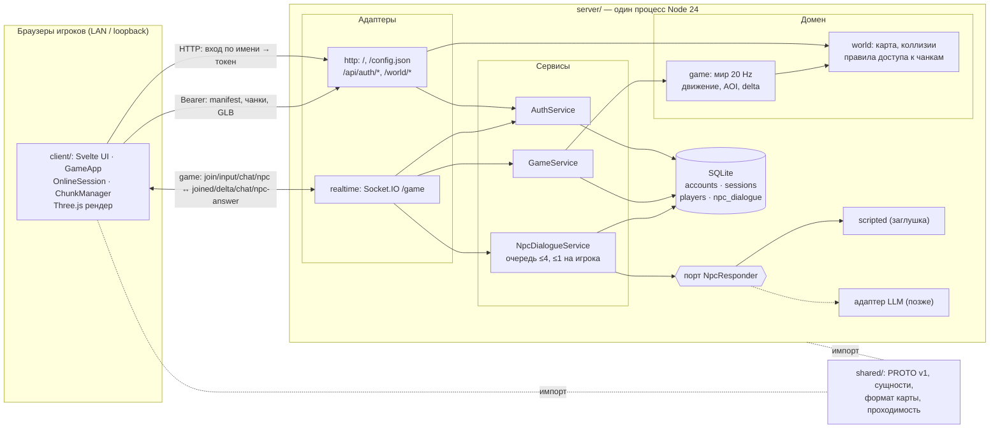

# Архитектура

## Система и границы

Учебный 3D-мир для максимум 4 одновременно активных игроков: общение, изучение истории/знаний через индивидуальных NPC. Приёмка включает всех четверых, в том числе одновременные вопросы NPC; число вкладок не расширяет playerId или квоты. Итоговая система работает без интернета: один ноутбук запускает сервер, SQLite и ИИ; другие используют только браузер. Второй сценарий — браузер и сервер на одном ноутбуке с отключённым Wi-Fi.

В этом репозитории реализован клиентский прототип; сервер создаётся в `server/` того же репозитория, общий исполняемый контракт — в корневом `shared/`. Новые NPC- и рыночные требования остаются отдельной работой. `server/`, БД, секреты и модели ИИ в клиентскую поставку не включаются. LocalSession — прогулка без игрового сервера. Тестовый сетевой режим использует OnlineSession с синтетическим участником и явно обозначенными ответами; он не подтверждает реальный мультиплеер, авторизацию, сохранения или ИИ.

## Мир, камера и управление

Сеттинг — стилизованный Вавилон с мягкими формами, кирпичными постройками, ступенчатым сооружением, пальмами и спокойной палитрой. Animal Crossing — ориентир атмосферы и пропорций, не источник скопированных ассетов. Авторская демо-карта содержит площадь, Квартал писцов и Сады науки. Район задаёт содержание, чанк — загрузку. Переход между районами сохраняет сессию, сцену и рендерер.

Камера следует за видимым персонажем от третьего лица; WASD работает относительно неё по физическим кодам клавиш. Pointer Lock запрашивается по явному входу/продолжению. Меню, диалог, чат, настройки, blur/visibility и потеря захвата сбрасывают ввод и освобождают курсор. Возврат требует нового клика; поздние результаты старого запроса не включают управление. Сложные взаимодействия и доступные состояния — UI/RENDER.

Качество персонажей определено в [CHAR](specs/character-presentation.md); клиентская реализация и ограничения приёмки — [TASK-029](tasks/029-character-presentation.md). Смешивание поз, темп походки по наблюдаемому перемещению, визуальные повороты и сопровождение камеры остаются в render; ввод передаёт намерения, а Core/сессия сохраняют полномочия над игровой позицией. Дополнительные фазы анимации не расширяют PROTO v1 и не требуют переноса Three.js в домен. Требования охватывают также человеческие модели, встроенные в статические GLB рынка.

## Клиентские модули

Один Vite-проект `client/`: TypeScript strict, Svelte 5 + CSS, Three.js, Socket.IO Client, Vitest. Без SvelteKit, DI-контейнера, полного ECS и переключения движков. GameApp — единственное место композиции реально используемых модулей.

| Модуль в client/src | Ответственность |
|---|---|
| app | GameApp, GameLoop, конфигурация, жизненный цикл, фасад UI и диагностика |
| core | Неизменяемые сериализуемые сущности/компоненты, локальная симуляция и replica; без внешних зависимостей |
| session | GameSession, LocalSession и OnlineSession; Core, нейтральный протокол и порт NetworkAdapter |
| render | RenderAdapter; Three.js только в three/, GLB/glTF, визуалы, камера и GPU-владение |
| map | HttpMapSource, ChunkManager, AssetManager и WorldBudget; данные без объектов Three.js |
| multiplayer | NetworkAdapter, SocketIOAdapter, MockNetworkAdapter, контролируемый тестовый обмен |
| input | DOM/Pointer Lock → намерения сессии и параметры камеры |
| ui | Svelte-экраны через фасад GameApp; без конкретных адаптеров |
| shared | Нейтральный протокол v1, runtime-схемы/fixtures и небольшие метаданные демо |

Импорты ацикличны. Core компилируется без DOM/Node; session не импортирует реализации транспорта. Socket.IO Client доступен только SocketIOAdapter. UI не зависит от ThreeRenderer/SocketIOAdapter. Границы проверяются dependency-cruiser и TypeScript.

GameWorld локально проверяет команды/расстояние, интегрирует XZ-движение, применяет нейтральный movement guard и генерирует события. В replica принимает авторитетный снимок и не назначает себе защищённые значения. LocalSession объединяет последний ввод и ограничивает очередь действий; начальная позиция приходит из manifest до симуляции.

GameLoop использует один планировщик кадров: 1/60 секунды, delta ≤0.1 секунды, максимум пять догоняющих шагов. В шаге опрашивается ввод, обновляется сессия, применяются сетевые данные, планируются чанки и синхронизируются визуалы; внутри кадра нет await. Render получает alpha. Скрытие/stop/start сбрасывают часы. Пауза останавливает симуляцию; при необходимости тот же цикл завершает очередь создания моделей и затем останавливается.

## Потоковая карта и ресурсы

HttpMapSource читает bootstrap → manifest → JSON/collision чанков. Демо генерируется перед dev/build/test/check: 1024 чанка по 32 м. `demo` начинает на площади, `science` — в садах того же связного мира. Общие GLB подготовлены локально, collision bitmap выводится из их геометрии; одинаковые BIN адресуются по SHA. В JS входит только небольшой bootstrap, полный мир загружается по требованию.

ChunkManager планирует от manifest spawn в LocalSession либо подтверждённой сервером позиции в OnlineSession. Радиус 0–2, по умолчанию 1, параллелизм 2. Радиус 0 заранее готовит ближайший переход. Текущий участок и ближайший переход приоритетны, дальние выгружаются. Поздние ответы отменённого поколения не создают чанки. Готовность и коллизии ограничивают локальное движение; при задержке UI показывает ожидание. Онлайн-клиент сообщает preparedChunks и ограничивает намерение, но позицию определяет сервер.

Лимит ≤10% измеряет уникальные сериализованные байты статического мира, включая manifest/чанки/collision/модели/зависимости. Общий объём получен из фактических уникальных файлов демо; в онлайне его и размеры ресурсов предоставляет сервер. Весь чанк резервируется атомарно до HTTP. Pending и CPU/GPU-владельцы удерживают резерв до последней ссылки. Дополнительно действует консервативный cap полезных данных 32 MiB; он не измеряет RSS браузера/драйвера. Метрика и ограничения — MAP.

AssetManager объединяет запросы через AsyncLeaseCache. GltfLibrary удерживает исходные leases, декодирует GLB/glTF и подготовленные локальные зависимости, разделяет геометрии/материалы/текстуры, создаёт независимые скелеты/AnimationMixer. Клонирование ограничено восемью объектами за кадр. VisualChunks держит статические группы, EntityVisuals — динамические сущности. Последний владелец освобождает GPU, текстуры, ImageBitmap и исходные байты. Смена карты/сессии ждёт освобождения старого бюджета, включая незавершённый декодер.

HTTP-запросы ограничены объявленным размером, cache no-store, redirect запрещён, service worker отсутствует. Реальный онлайн использует защищённый `<serverUrl>/world/` с серверной сессией; публичное демо не служит fallback для настоящего мира.

## Сеть и UI

PROTO v3 находится в корневом `shared/protocol/`, который импортируют обе стороны: строгие runtime-схемы и переносимые JSON fixtures. Namespace `/game`, событие `game`, handshake `{version:3, token}`. Транспорт создаётся только при действующем серверном контексте; mock имеет отдельный явный контекст. Токен хранится в памяти и передаётся HTTP/Socket.IO адаптерам. `GameApp.login`/регистрация вызывают парольный HTTP API; `provideServerSession` принимает валидированный ответ. Отдельный `/api/auth/state` сообщает обязательный first-avatar, а logout отзывает текущую серверную сессию. Svelte показывает имя, ожидание, ошибки и повторный вход; токен остаётся в памяти.

SocketIOAdapter подключается явно, без встроенного autoConnect/reconnection. Retry 1/2/4 секунды, максимум три попытки; отказ авторизации/версии терминален. Истечение, logout/dispose отменяют таймеры/подписки и закрывают канал. Транспорт не накапливает действия для повтора после разрыва; важные действия ожидают коррелированное подтверждение с timeout.

OnlineSession получает playerId и AOI при join, хранит replica. Последующие снимки/дельты применяются на update; входная очередь ограничена восемью пакетами, переполнение/разрыв revision вызывает resync. После reconnect всегда новый join, старые действия не воспроизводятся. Отдельная история восьми снимков даёт интерполяцию всех игроков, включая цель камеры, с задержкой 100 ms; авторитетное состояние не интерполируется.

UI отображает загрузку, связи/ошибки, взаимодействия NPC, чат карты (50 последних сообщений), настройки режима/адреса/карты/радиуса/debug. Текст выводится через Svelte как текст. Native dialog ограничивает фокус. Координаты обновляются до 10 раз в секунду, производительность — раз в секунду; трансформации каждого кадра не проходят через Svelte.

## Сервер

Коротко для защиты:
- **Подгрузка и кеш.** Клиент получает bootstrap мира в `joined` и грузит manifest и чанки по `/world/*` вокруг авторитетной позиции. Сервер отдаёт только чанки в радиусе 3 от игрока, а клиент держит окно до 25 чанков с защитой полезных данных 64 MiB.
- **Данные игроков** — в SQLite на серверном ноутбуке: аккаунты по имени, сессии (только хеш токена), позиция игрока, история диалогов с NPC, группы/роли BABEL, языки, задание, инвентарь, камни и личный словарь.
- **Авторизация.** Регистрация/парольный вход дают токен на 12 ч; пароль хранится как salted scrypt, токен — только как SHA-256. Старый demo guest не обходит password account. Токен проверяется при handshake Socket.IO и защищённых HTTP-запросах; logout удаляет сессию и закрывает только её transport. Pending-avatar password account не допускается к join. Одно управляющее соединение на игрока, не больше 4 игроков.
- **Сеть.** Клиент шлёт намерения до 20 Hz. Сервер считает мир на 20 Hz и рассылает изменения AOI до 10 Hz с монотонной revision.

Сервер живёт в этом репозитории, в `server/`, рядом с `client/`. Это отдельное приложение со своим `package.json`; npm workspaces и общий пакет не используются. Стек: **Node.js 24, TypeScript strict, Socket.IO 4.8, встроенный `node:sqlite`, Vitest**. HTTP — встроенный `node:http`, без web-фреймворка. Код запускается встроенным в Node удалением типов, без отдельной сборки; `tsc --noEmit` выполняет только проверку типов. Если закреплённая версия Node этого не поддерживает, TASK-010 фиксирует запасной путь сборки. Подробности — [SERVER](specs/server-foundation.md).

Один процесс — модульный монолит, не микросервисы. Тяжёлые операции не выполняются на игровом шаге: БД не вызывается из шага (сохранение по таймеру), генерация ответа NPC — за асинхронным портом. Будущая LLM работает в собственном процессе по [LLM](specs/server-llm-runtime.md).

| Модуль в server/src | Слой | Ответственность |
|---|---|---|
| app | composition root | main, загрузка/проверка config, сборка модулей, запуск и штатная остановка |
| http | адаптер | node:http: раздача клиента, `config.json`, `/api/*`, `/world/*`; CORS для dev; вызывает AuthService и правила доступа world |
| realtime | адаптер | Socket.IO `/game`: handshake, разбор пакетов shared-парсером, лимиты частоты, вызов GameService/NpcDialogueService, отправка пакетов |
| auth | сервис + порты | AuthService: register/login, salted scrypt, ограниченные попытки, guest-совместимость, сессии/отзыв и pending-avatar state; порты `AccountStore`, `SessionStore` |
| game | домен + сервис | Домен: мир, tick 20 Hz, движение/коллизии, взаимодействия, AOI, revision/delta, слоты (≤4) и управляющее соединение. GameService: join/input/interact/chat/resync/присутствие; порты `PlayerStore`, `Clock` |
| world | домен + адаптер | Домен: модель карты, bootstrap, проходимость, правила доступа к файлам, NPC-контент. Адаптер `loader`: чтение и проверка worldDir/contentDir при старте |
| npc | сервис + порт + адаптеры | NpcDialogueService, планировщик (≤4 незавершённых, ≤1 на игрока); порты `NpcResponder`, `DialogueStore`; адаптер-заглушка `scripted` |
| persistence | адаптер | SQLite (`DatabaseSync`), миграции, реализации Store-портов |

Модули разделены по функциям, внутри каждого — по слоям. Направление зависимостей — к домену: `app → адаптеры (http, realtime, persistence, world/loader, npc/adapters) → сервисы (auth, game, npc) → домен (game/world, world/map) → shared`.

Принципы чистой архитектуры сервера, без оверинжиниринга:

- **Домен чистый.** Мир, движение, AOI, delta, правила взаимодействия и коллизии — детерминированный код без IO, таймеров и `Date.now()`. Время передаётся через `dt` и порт `Clock`. Домен тестируется без сети и БД.
- **Сервисы (use cases)** — `AuthService`, `GameService` (join, input, interact, chat, resync, присутствие), `NpcDialogueService`. Они оркестрируют домен и порты, не зная о Socket.IO, HTTP и SQL.
- **Порты объявляет потребитель и только на реальной границе:** хранилище (`AccountStore`, `SessionStore`, `PlayerStore`, `DialogueStore`), `NpcResponder`, `Clock`/таймеры. Модули внутри процесса вызывают друг друга напрямую, без интерфейса ради интерфейса.
- **Адаптеры тонкие.** Цепочка «разбор shared-парсером → вызов сервиса → сериализация». Коды PROTO и HTTP-статусы назначаются только в адаптере. Сервис возвращает результат как значение (discriminated union), а исключение означает непредвиденный сбой.
- **Composition root — только `app`.** Зависимости передаются в конструктор явно, без DI-контейнера, глобальных singleton и service locator. Конфигурация читается один раз и передаётся по частям.
- **Одна ответственность на модуль и класс.** Функции — там, где не нужно состояние. Имена отражают предметную область PROTO/спек.
- **Чего не делаем:** generic event bus, CQRS, базовые generic-репозитории, абстрактные фабрики, плагинные системы. Единственный реестр — `npc.adapter → factory`. Нет слоёв-прокладок, которые только пересылают вызов.

Модуль game не импортирует realtime/http/persistence. Конкретные адаптеры подключает только app. Импорты ацикличны, правила проверяются автоматически (SERVER-002).

**`shared/`** в корне — исполняемый общий контракт: типы и runtime-валидация PROTO v1, формы сущностей, формат manifest/чанков и правило проходимости ([SHARED](specs/shared-contracts.md)). Это чистый TypeScript без зависимостей, DOM и Node. Сервер импортирует его с первого коммита. Клиент и сервер используют одну копию контракта. Перенос клиента выполнен отдельной TASK-027 по явному уточнению пользователя; клиентские команды, сессии, кеш и рендер остаются в client/. Клиентские доработки для интеграции сервера разрешены пользователем; серверный runtime по-прежнему не импортирует client/.

Сервер авторитетен: назначает playerId, позицию, результат взаимодействия и ответ NPC. Клиент присылает только намерения. Вход — `POST /api/auth/register` и `/api/auth/login` с `{name,password}` → строго `{token, expiresAt}`, одно имя — один игрок. Клиент передаёт ответ в `GameApp.provideServerSession()` и отдельно читает Bearer `/api/auth/state` → `{requiresAvatar}`. Парольный игрок с NULL avatar сохраняет pending-состояние между перезапусками и не может выполнить join до подтверждения. `/api/auth/logout` отзывает текущий токен; игровой transport получает целевое уведомление по хешу сессии, закрывается и отменяет NPC. Demo `/api/auth/guest` остаётся только для guest accounts; регистрация не присваивает старые guest-имена. Один аккаунт — один игрок и одно управляющее соединение: новое соединение того же аккаунта атомарно перехватывает управление ([AUTH](specs/server-auth.md)). Реализуемый контракт — PROTO v3, который уже поддержан клиентом. BABEL/SCENE (перевод чата, камень, задание, инвентарь, словарь) использует отдельный HTTP-подконтракт PROTO-009 с v:2. Потоковый ответ NPC PROTO-007 реализован сервером как opt-in stream; клиентская интеграция остаётся отдельным этапом.

NPC в v1 отвечают через порт `NpcResponder` ([NPC](specs/server-npc-dialogue.md)). В реестре есть детерминированная заглушка `scripted` и явно выбираемые `ollama`/`mlx`; LLM подключена к тому же порту без изменения realtime/game. Установленные локальные артефакты/версии задаёт оператор. Startup selector в app читает внешнюю versioned коллекцию подготовленных профилей (runtime+модель+tokenizer+pins целиком), применяет сохранённую пару либо Make/CLI override в памяти, без изменения игрового config. При отсутствии коллекции сохраняется legacy config; ошибка явно выбранного профиля не включает fallback. Отдельный create-only importer переносит доверенные локальные настройки без inference/download, сохраняя deadline30с и выбирая2B. Нового inference-порта, очереди или composition root не вводится. Общий POSIX supervisor держит приватный bounded IPC к одному Python-worker, а worker владеет inference. Живой статус отражается в health; восстановление не повторяет пользовательский вопрос. Один активный вызов; общий v1 deadline настраивается целыми секундами через Make NPC_TIMEOUT=60 (1–300с/default30с, очередь включена), override не пишет config/profile. Общие bounds/grace находятся в pure shared. Публичный HTTP `/api/game-config` отдаёт только effective npcTimeoutMs; HTTPadapter клиента загружает его с actual serverUrl на каждом connect/reconnect, headless OnlineSession получает provider и отбрасывает stale/cancelled metadata. До валидной metadata NPC недоступен, без блокировки мира/чата. NPC pending равен сроку сервера плюс2с, остальные запросы10с. Supervisor и Python используют оставшийся deadline, не скрытый30с cap. Wire shapes v1 не меняются; это увеличение аварийного лимита, не qualification скорости. Подробности и ограничения — [server/llm/README](server/llm/README.md). Ни заглушка, ни fixture-тесты worker не подтверждают приёмку AI/LLM; реальный hardware/модель/OS-isolation ещё не квалифицированы.

Общий контракт — [PROTO](specs/protocol.md). Клиент никогда не присваивает авторитетные защищённые значения.

## Локальная LLM и NPC

Два backend: MLX LM на Apple Silicon и Ollama на поддерживаемых Windows/macOS (Intel Mac — CPU, требования ОС проверяются). Это серверная настройка, не LocalSession/OnlineSession. Один backend и одна модель обслуживают всех NPC; одновременная загрузка двух запрещена. Модель и runner закрепляются версиями/хешами; подготовка артефактов выполняется заранее. Браузер не имеет прямого доступа к inference endpoint.

**Следующий этап v2, не реализован текущим адаптером v1:** `NpcDialogueService` координирует права, lifecycle, `GenerationScheduler`, `KnowledgeSource`, `MemoryService`, `DialogueRepository`, `PromptBuilder` и `LlmPort`; `MlxAdapter`/`OllamaAdapter` изолируют inference. MLX работает в отдельном локальном Python-worker, не навязывая язык остальному серверу. Поиск MVP — SQLite FTS5 с тематическими/межъязыковыми aliases, без отдельной embedding-модели. История ответов хранится отдельно от ограниченной детерминированной памяти; модель не выполняет SQL, ОС-команды и игровые действия.

Общий бюджет LLM — не более 4 000 000 000 байт RAM для всех процессов, контекстов и AI-кешей/буферов вместе. Начальный контекст на запрос 2048 токенов, вход ≤1792, стандартный выход до 128, расширенный до 256; thinking выключен. GenerationScheduler допускает всего 4 незавершённых запроса, по одному на игрока. Базовый профиль maxConcurrentGenerations=1; профиль 2 принимается после сравнения на том же железе, без копирования весов и смешения KV/recurrent state. FIFO, индивидуальная отмена и общий runtime-restart не останавливают мир. Слот не переиспользуется до физической остановки вычисления. Профиль включает CPU thread limits и проверяется вместе с сервером/браузером, а не только в изолированном LLM benchmark.

Временный streaming передаёт ограниченные полные partial-снимки текста без per-fragment ACK/replay; клиент заменяет текст, пропуски снимков допустимы. Финал отправляется после SQLite commit, восстановление читает result без новой generation. Буферы приложения и транспорта ограничены; сбой доставки не отменяет durable-результат. Цели single-request и 4-player burst заданы в LLM/LLM-QA; это требования, не результаты замеров.

Детали — [LLM](specs/server-llm-runtime.md), [AI](specs/server-ai.md), [STORE](specs/server-persistence.md), [NPC-подконтракт](specs/protocol.md) и [LLM-QA](specs/npc-llm-evaluation.md). Основная модель выбрана по исследованию, но скорость, русский язык, артефакты MLX и общий пик RAM должны пройти проверку на целевом железе. Резервный Qwen3-1.7B не включается автоматически.

## Приёмка и оставшаяся интеграция

Клиентские TASK-003–005/019/020 имеют собственные доказательства; TASK-006–009 сохраняют прежние измерения и переоткрыты для NPC-подконтракта из main; PROTO-007 отнесён к v2, NPC-часть UI-005/NET-004 для v1 уточнена. Профиль Chrome/Apple M4, бюджеты и полный прогон описаны в QUALITY/TASK-008. Оптимизации instancing/LOD вводятся по измеренной необходимости.

Общие ограничения:

- Runtime без интернета: ресурсы, модели, декодеры и зависимости подготовлены заранее. Никаких CDN или внешних ИИ API во время игры.
- Кеш клиента ≤10% уникальных сериализованных байтов статического мира по MAP; pending и CPU/GPU-владельцы резервируются до последней ссылки. Отдельный консервативный cap полезных данных 32 MiB не измеряет RSS браузера/драйвера. HTTP no-store, скрытой предзагрузки нет. Сервер должен предоставить совместимый bootstrap/manifest.
- Для сервера выбраны runtime, вход, handshake, частоты (симуляция 20 Hz, рассылка 10 Hz), коллизии по bitmap чанков и интервал сохранения (10 с). Остаются: реальный ответ LLM в настроенный общий лимит (default30с, клиент ждёт срок сервера плюс2с) и квалификация качества; streaming/durable lifecycle требуют PROTOv2, упаковка клиента для онлайн-поставки без публичных `maps/` и подготовка учебных материалов/квалификация оборудования для ИИ.
- LAN-трафик идёт по HTTP без TLS: токены в локальной сети не шифруются. Это принятый риск офлайн-демо, не продакшн-модель.
- Целевые браузеры, оборудование и бюджеты производительности определяются до итоговых замеров.
- WebXR/VR-шлем, транспортная физика, бой, квестовая система и редактор карты не входят в текущий MVP.

CLIENT S4 (второй физический ноутбук и реально отключённый Wi-Fi) не выполнен. NET-007/DEMO требуют реального входа, сервера `server/`, SQLite и адаптивного ИИ; mock этого не доказывает. Вход, серверный runtime, авторитетные коллизии/AOI и сохранения выбраны в серверных спеках ([SERVER](specs/server-foundation.md), [AUTH](specs/server-auth.md), [REALTIME](specs/server-realtime.md)) и проверяются задачами сервера; модель/backend LLM выбраны в серверных спеках и ещё требуют квалификации. PROTO задаёт совместимость, но не доказывает её до TASK-016. WebXR, бой, квесты и редактор вне MVP.

Требования [GAME](specs/game-babylon.md) и [MARKET](specs/demo-scene-market.md) сохранены из main. Сетевой NPC v1 (`npc-question`/`npc-answer`) — текущий контракт; PROTO-007 (partial/cancel/preferences/durable result) — v2. Рыночная сцена и её локальный маршрут реализованы на клиенте отдельно от серверной приёмки. Для v2 нужны новые runtime-схемы и сценарии; проверка прежнего клиента этого не подтверждает.

## Клиентский стенд рынка

Карта `market` по умолчанию использует отдельные GLB рынка и пастбища, окружающие потоковые чанки и тот же WorldBudget. Генератор сохраняет проверяемые коллизионные прямоугольники в GLB; визуальные ступени проходимы без изменения высоты симуляции. Именованные группы рук и голов анимированы в GLB. ThreeRenderer включает для этой карты закатный свет, мягкие тени и приближение камеры при препятствии; исходные карты сохраняют прежний профиль.

<<<<<<< HEAD
MarketSession расширяет LocalSession только для клиентского стенда: проверяет близость при покупке/кормлении, хранит ограниченные инвентарь, камни и словарь в памяти. GameApp остаётся фасадом UI; переход в OnlineSession не переносит эти данные. Это не серверные игровые полномочия, не реализация совместных ролей, перевода или SQLite. Серверный BABEL-режим подключается отдельно, через BabylonClient; данные локального стенда в него не переносятся.

## BABEL и главное здание

GameApp перед первым online join карты market загружает BABEL-профиль и проводит выбор режима/языков. BabylonClient передаёт намерения в `/api/babylon`, опрашивает ограниченный личный снимок раз в секунду, отменяет запросы при выходе и сохраняет requestId для безопасного повтора. BabylonPanel отображает подтверждённые данные и блокирует управление. Роли, правила и приватность проверяет BabylonService; SQLite-миграция 002 хранит ограниченные агрегаты и receipts в одной транзакции. Движение и AOI идут через Socket.IO v3.

Режимы 2–4 разделяют список пастуха (роль 1) и покупки/кормление (роли 2–4); соло объединяет обязанности. Первое появление принудительно использует точку роли даже у аккаунта со старым сохранением демо. После сохранения точки флаг первого появления снимается; переподключение восстанавливает последнюю позицию.

Перевод, подсказки словаря и NPC используют одну GenerationQueue с прежними NPC: максимум четыре незавершённых запроса, один на playerId, базовый параллелизм один. Один чат-запрос последовательно переводит текст на уникальные целевые языки. LanguagePort — граница локального адаптера, передаваемая четвёртым аргументом startApplication. Текущий явно обозначенный test backend не является fallback и не подтверждает LLM-QA. Ollama и реальный адаптер выполняются отдельной работой; их lifecycle и единая модель должны подключаться в app, без второй независимой очереди. Логируются тип операции, время и успех, без пользовательских текстов.

Здание и двор находятся в чанке market/-1_0, западнее рынка. Именованные части main-building.glb потоково загружаются вместе; повторяющиеся props делят геометрию, babel-symbols включается отдельно. Камера во дворе плавно увеличивает расстояние/угол обзора, продолжая проверять препятствия. Лестница и нижняя площадка имеют серверную высоту через optional heightSurfaces manifest; общая чистая формула используется локальным движением. Верхние ярусы и интерьер недоступны. Все ресурсы, включая модель и manifest, учитываются общей защитой памяти окна чанков.

Данные MOVE ceilingVolumes подготовлены в manifest: ≤128 общих и ≤128 на запись чанка, с разбиением по границам и выборкой из существующего пространственного индекса. Manifest учитывается прежней защитой 64 MiB; новых runtime-источников/циклов нет. Выносливость не сохраняется в SQLite: в живом world сохраняется сущность или краткоживущий долг после grace, позиция для SQLite — последняя безопасная опора.

## Живой мир и переноска (частичная реализация NEXT)

[NEXT-006/010/011/015](specs/world-next-stage.md) реализуются ограниченными [server/shared](tasks/055-world-contract-server.md), [клиентской](tasks/056-world-client.md) и [аудиозадачей](tasks/057-world-audio.md). Приёмка остаётся открытой: [evidence](tasks/evidence/world-next/acceptance.md). Остальные направления NEXT этим блоком не реализуются.

`shared/world-life/` содержит чистые типы, строгие runtime-парсеры/fixtures, детерминированные функции фаз и авторские данные `market.ts`. Генератор помещает определение в `manifest.worldLife`; каталог отдельных SCENE/BUILDING-моделей и экземпляры разделены. Сервер проверяет ссылки, количества, зоны и маршруты при запуске. Отдельный Socket.IO event `world-life` v1 передаёт ограниченный полный map-local снимок с sceneId/revision/serverTimeMs/epochMs, 4 горшками и 5 яблоками; намерения `hand` и `scene-sync` используют те же auth/control checks. MOVE остаётся PROTO v3 без скрытых полей. Клиент, сервер и мир обновляются одной поставкой.

Чистый `game/WorldLife` использует карты/геометрию и существующий world step; отдельного симуляционного цикла, event bus или физического движка нет. Толкание планируется по подтверждённому MOVE и проверяется до изменения RAM. Горшки не входят в baked декор/bitmap; их исходные координаты и зоны — данные карты. `GameService` оркестрирует руки через `WorldLifeStore`; SQLite-адаптер и миграция 008 атомарно сохраняют пять ID, один слот на holder и durable receipts. Повтор requestId возвращает прежний результат без повторного действия; смена намерения под тем же ID даёт конфликт. Подбираемые яблоки не меняют инвентарь BABEL. Полный снимок сцены независим от revision AOI; receipt сам не заменяет текущее владение.

`OnlineSession` отправляет F по фронту, показывает ожидание/отказ и принимает владение только из подтверждённого снимка. Явный `MockWorldLife` находится на транспортной границе и не включается при сбое backend. `WorldLifeVisuals` пользуется существующими GltfLibrary/leases/очередью клонирования, создаёт фон только в готовых чанках и крепит переносимое яблоко к суставу руки видимого владельца, независимо от статического home-чанка. Кошки и стая воспроизводят общую сцену, ветер меняет только подходящие визуальные узлы, не коллизии.

`audio/WorldAudio` — браузерная презентация через lifecycle GameApp, вне headless Core/shared. Источники/буферы не сохраняются на сервере. Семь локальных оригинальных WAV загружаются лениво, HTTP/PCM/source reserves используют тот же WorldBudget 64 MiB. До измерений установлены caps: 8 источников, 2 загрузки, 7 decoded buffers, 8 motion IDs, 32 потока и 512 recent message IDs. Один уровень 30%/0% хранится отдельно от токенов/профиля. Действия получают фактические авторитетные movement samples; snapshot/history/correction задают тихую базу, отсутствующие player IDs освобождают tracking-слоты. Бормотание не получает текст; BABEL chat identity включает authorId + message ID. GameApp освобождает аудио до замены бюджета/сцены; повторный join создаёт новый экземпляр и тихую базу истории. Физическое прослушивание и аппаратная квалификация не заменяются автоматизацией.

Повторяющиеся непрозрачные wind-поверхности внутри одного GLB объединяет `WindInstances`: прежние pivots и матрицы определяют анимацию, geometry/material остаются общими, instance buffers освобождаются до release модели. Камера продолжает проверять исходные поверхности. Дополнительные матрицы ограничены 1024 экземплярами (64 KiB) на модель внутри её прежнего консервативного резерва; лимит WorldBudget не увеличивается. Основание — измеренное превышение draw-call бюджета и проверка TASK-054.
## Вход через кабинет и загрузку

[HUB](specs/client-game-hub.md) отделяет профиль (имя, облик, языки) от игрового задания. Языки сохраняются до задания, profile.groupId может быть null. Команды create/join разделены; старый enroll остаётся для совместимости. Смена IP/порта не переносит bearer другого сервера; авторизация выполняется на целевом сервере.

[LOAD](specs/client-world-entry.md) разделяет готовность авторитетного мира и визуальную анимацию. Подъём принадлежит VisualChunks/renderer и не двигает коллизии или сущности. Сервер удерживает безопасную точку появления до готовности, клиент не накапливает ввод. Фазы GameApp координируют загрузку, анимацию и захват; браузерный отказ Pointer Lock остаётся явным восстанавливаемым состоянием. Проверки и свидетельства реализации — [TASK-050](tasks/050-profile-entry-flow.md).
=======
MarketSession расширяет LocalSession только для клиентского стенда: проверяет близость при покупке/кормлении, хранит ограниченные инвентарь, камни и словарь в памяти. GameApp остаётся фасадом UI; переход в OnlineSession не переносит эти данные. Это не серверные игровые полномочия, не реализация совместных ролей, перевода или SQLite. Серверные границы и открытые решения BABEL/SCENE не меняются.
>>>>>>> 954930d (feat(server): integrate configurable Ollama and MLX NPC responders)
