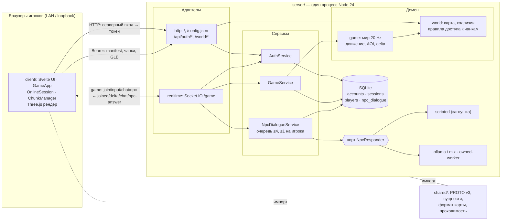

# Архитектура

## Система и границы

Офлайн 3D-игра для изучения языка, максимум 4 одновременно активных игрока: общение, изучение истории/знаний через индивидуальных NPC. Приёмка включает всех четверых, в том числе одновременные вопросы NPC; число вкладок не расширяет playerId или квоты. Итоговая система работает без интернета: один ноутбук запускает сервер, SQLite и ИИ; другие используют только браузер. Второй сценарий — браузер и сервер на одном ноутбуке с отключённым Wi-Fi.

В репозитории реализованы клиент и сервер `server/` с авторитетным миром, SQLite и механиками BABEL; общий исполняемый контракт — в корневом `shared/`. Адаптеры локальной LLM интегрированы отдельным срезом; реальная модель и её квалификация остаются незавершённой работой. `server/`, БД, секреты и модели ИИ в клиентскую поставку не включаются. LocalSession — прогулка без игрового сервера. Тестовый сетевой режим использует OnlineSession с синтетическим участником и явно обозначенными ответами; он не подтверждает реальный мультиплеер, авторизацию, сохранения или ИИ.

## Мир, камера и управление

Сеттинг — стилизованный Вавилон с мягкими формами, кирпичными постройками, ступенчатым сооружением, пальмами и спокойной палитрой. Animal Crossing — ориентир атмосферы и пропорций, не источник скопированных ассетов. Авторская демо-карта содержит площадь, Квартал писцов и Сады науки. Район задаёт содержание, чанк — загрузку. Переход между районами сохраняет сессию, сцену и рендерер.

Камера следует за видимым персонажем от третьего лица; WASD работает относительно неё по физическим кодам клавиш. Pointer Lock запрашивается по явному входу/продолжению. Меню, диалог, чат, настройки, blur/visibility и потеря захвата сбрасывают ввод и освобождают курсор. Возврат требует нового клика; поздние результаты старого запроса не включают управление. Сложные взаимодействия и доступные состояния — UI/RENDER.

Качество персонажей определено в [CHAR](specs/character-presentation.md); клиентская реализация и ограничения приёмки — [TASK-029](tasks/029-character-presentation.md). Смешивание поз, темп походки по наблюдаемому перемещению, визуальные повороты и сопровождение камеры остаются в render; ввод передаёт намерения, а Core/сессия сохраняют полномочия над игровой позицией. Дополнительные презентационные фазы анимации не расширяют игровой протокол и не требуют переноса Three.js в домен. Требования охватывают также человеческие модели, встроенные в статические GLB рынка.

Расширение движения описано в [MOVE](specs/character-movement.md): контакт со стенами, прыжки, спринт и выносливость с круговым HUD. Согласованы игровая версия Socket.IO v3 и AABB перекрытий; общая чистая кинематика shared/movement вызывается существующими циклами LocalSession и server World. Сервер остаётся авторитетным, а позы и HUD — клиентским представлением. Серверная и клиентская части выделены в отдельные задачи; v1/v2 игрового Socket.IO отклоняются; HTTP BABEL и пара NPC сохраняют собственные подконтракты.

## Клиентские модули

Один Vite-проект `client/`: TypeScript strict, Svelte 5 + CSS, Three.js, Socket.IO Client, Vitest. Без SvelteKit, DI-контейнера, полного ECS и переключения движков. GameApp — единственное место композиции реально используемых модулей.

| Модуль в client/src | Ответственность |
|---|---|
| app | GameApp, GameLoop, конфигурация, жизненный цикл, фасад UI и диагностика |
| core | Неизменяемые сериализуемые сущности/компоненты, локальная симуляция и replica; без внешних зависимостей |
| session | GameSession, LocalSession и OnlineSession; Core, нейтральный протокол и порт NetworkAdapter |
| render | RenderAdapter; Three.js только в three/, GLB/glTF, визуалы, камера и GPU-владение |
| map | HttpMapSource, ChunkManager, AssetManager и WorldBudget; данные без объектов Three.js |
| multiplayer | BabylonClient (HTTP-команды и polling личного состояния), NetworkAdapter, SocketIOAdapter, MockNetworkAdapter, контролируемый тестовый обмен |
| input | DOM/Pointer Lock → намерения сессии и параметры камеры |
| ui | Svelte-экраны через фасад GameApp; без конкретных адаптеров |
| shared | Нейтральный протокол v3, runtime-схемы/fixtures и небольшие метаданные демо |

Импорты ацикличны. Core компилируется без DOM/Node; session не импортирует реализации транспорта. Socket.IO Client доступен только SocketIOAdapter. UI не зависит от ThreeRenderer/SocketIOAdapter. Границы проверяются dependency-cruiser и TypeScript.

GameWorld локально проверяет команды/расстояние, интегрирует XZ-движение, применяет нейтральный movement guard и генерирует события. В replica принимает авторитетный снимок и не назначает себе защищённые значения. LocalSession объединяет последний ввод и ограничивает очередь действий; начальная позиция приходит из manifest до симуляции.

GameLoop использует один планировщик кадров: 1/60 секунды, delta ≤0.1 секунды, максимум пять догоняющих шагов. В шаге опрашивается ввод, обновляется сессия, применяются сетевые данные, планируются чанки и синхронизируются визуалы; внутри кадра нет await. Render получает alpha. Скрытие/stop/start сбрасывают часы. Пауза останавливает симуляцию; при необходимости тот же цикл завершает очередь создания моделей и затем останавливается.

## Потоковая карта и ресурсы

HttpMapSource читает bootstrap → manifest → JSON/collision чанков. Демо генерируется перед dev/build/test/check: 1024 чанка по 32 м. `demo` начинает на площади, `science` — в садах того же связного мира. Общие GLB подготовлены локально, collision bitmap выводится из их геометрии; одинаковые BIN адресуются по SHA. В JS входит только небольшой bootstrap, полный мир загружается по требованию.

ChunkManager планирует от manifest spawn в LocalSession либо подтверждённой сервером позиции в OnlineSession. Радиус 0–2, по умолчанию 2 для market и 1 для demo/science, параллелизм 2. Радиус 0 заранее готовит ближайший переход. Текущий участок и ближайший переход приоритетны, дальние выгружаются. Поздние ответы отменённого поколения не создают чанки. Готовность и коллизии ограничивают локальное движение; при задержке UI показывает ожидание. Онлайн-клиент сообщает preparedChunks и ограничивает намерение, но позицию определяет сервер.

Индекс чанков по координатам ограничивает поиск окрестностями игрока. Неизменившиеся позиция, радиус и бюджет не требуют нового плана. Изменение порядка приоритетов будит отложенные чанки даже внутри текущей области; освобождение бюджета также допускает повтор. Вытеснение защищает footprint игрока. Повторное вытеснение одной пары чанков запрещено до изменения приоритетов, явного retry или освобождения бюджета другим владельцем, а временно удержанные от предзагрузки участки возвращаются после завершения попытки. Это предотвращает цикл выгрузки/загрузки при невозможном резервировании. Диагностика отдельно показывает загрузку и отложенные из-за бюджета чанки.

Клиент держит окно до 25 чанков и выгружает дальние. Уникальные сериализованные байты manifest/чанков/collision/моделей/зависимостей учитываются для диагностики, без процентного лимита кеша. Общий объём получен из фактических уникальных файлов демо; в онлайне его и размеры ресурсов предоставляет сервер. Весь чанк резервируется атомарно до HTTP. Pending и CPU/GPU-владельцы удерживают резерв до последней ссылки. Дополнительно действует консервативный cap полезных данных 64 MiB; он не измеряет RSS браузера/драйвера. Метрика и ограничения — MAP.

AssetManager объединяет запросы через AsyncLeaseCache. GltfLibrary удерживает исходные leases, декодирует GLB/glTF и подготовленные локальные зависимости, разделяет геометрии/материалы/текстуры, создаёт независимые скелеты/AnimationMixer. Клонирование ограничено восемью объектами за кадр. VisualChunks держит статические группы, EntityVisuals — динамические сущности. Последний владелец освобождает GPU, текстуры, ImageBitmap и исходные байты. Смена карты/сессии ждёт освобождения старого бюджета, включая незавершённый декодер.

Пять проб камеры используют точную геометрию. CameraRaycast ускоряет обычные крупные Mesh ограничивающими коробками диапазонов по 128 треугольников; vertex/index-буферы не копируются и дополнительные GPU-ресурсы не создаются. Индекс хранится в WeakMap по общей геометрии, пересчитывается при изменении версии буфера, а текущая matrixWorld учитывает перемещение объектов. Skinned/morph/instanced и нестандартные raycast остаются на обычном пути Three.js. Матрицы сцены обновляются один раз перед пробами и отрисовкой; матрица камеры по-прежнему обновляется рендерером.

HTTP-запросы ограничены объявленным размером, cache no-store, redirect запрещён, service worker отсутствует. Реальный онлайн использует защищённый `<serverUrl>/world/` с серверной сессией; публичное демо не служит fallback для настоящего мира.

## Сеть и UI

PROTO v3 находится в корневом `shared/protocol/`, который импортируют обе стороны: строгие runtime-схемы и переносимые JSON fixtures. Namespace `/game`, событие `game`, handshake `{version:3, token}`. Транспорт создаётся только при действующем серверном контексте; mock имеет отдельный явный контекст. Токен хранится в памяти и передаётся HTTP/Socket.IO адаптерам. `GameApp.login`/регистрация вызывают парольный HTTP API; `provideServerSession` принимает валидированный ответ. Отдельный `/api/auth/state` сообщает обязательный first-avatar, а logout отзывает текущую серверную сессию. Svelte показывает имя, ожидание, ошибки и повторный вход; токен остаётся в памяти.

Выбор входа следует `/api/auth/mode`; поддерживаются смена пароля и разрешённый guest/dev. Revision auth-контекста сбрасывает поля и отменяет старые запросы при смене сервера; поздний login/logout не меняет новый контекст. Reload-restoration не реализован. Полная приёмка и необязательные отчёты остаются в TASK-044.

SocketIOAdapter подключается явно, без встроенного autoConnect/reconnection. Retry 1/2/4 секунды, максимум три попытки; отказ авторизации/версии терминален. Истечение, logout/dispose отменяют таймеры/подписки и закрывают канал. Транспорт не накапливает действия для повтора после разрыва; важные действия ожидают коррелированное подтверждение с timeout.

OnlineSession получает playerId и AOI при join, хранит replica. Последующие снимки/дельты применяются на update; входная очередь ограничена восемью пакетами, переполнение/разрыв revision вызывает resync. После reconnect всегда новый join, старые действия не воспроизводятся. Отдельная история восьми снимков даёт интерполяцию всех игроков, включая цель камеры, с задержкой 100 ms; авторитетное состояние не интерполируется.

UI отображает загрузку, связи/ошибки, взаимодействия NPC, чат карты (50 последних сообщений), настройки режима/адреса/карты/радиуса/debug. Текст выводится через Svelte как текст. Native dialog ограничивает фокус. Координаты обновляются до 10 раз в секунду, производительность — раз в секунду; трансформации каждого кадра не проходят через Svelte.

## Сервер

Коротко для защиты:
- **Подгрузка и кеш.** Клиент получает bootstrap мира в `joined` и грузит manifest и чанки по `/world/*` вокруг авторитетной позиции. Сервер отдаёт только чанки в радиусе 3 от игрока, а клиент держит окно до 25 чанков с защитой полезных данных 64 MiB.
- **Данные игроков** — в SQLite на серверном ноутбуке: аккаунты по имени, сессии (только хеш токена), позиция игрока, история диалогов с NPC, группы/роли BABEL, языки, задание, инвентарь, камни и личный словарь.
- **Авторизация.** Регистрация/парольный вход дают токен на 12 ч; пароль хранится как salted scrypt, токен — только как SHA-256. Старый demo guest не обходит password account. Токен проверяется при handshake Socket.IO и защищённых HTTP-запросах; logout удаляет сессию и закрывает только её transport. Pending-avatar password account не допускается к join. Одно управляющее соединение на игрока, не больше 4 игроков.
- **Сеть.** Клиент шлёт намерения до 20 Hz. Сервер считает мир на 20 Hz и рассылает изменения AOI до 10 Hz с монотонной revision.

Сервер живёт в этом репозитории, в `server/`, рядом с `client/`. Это отдельное приложение со своим `package.json`; npm workspaces и общий пакет не используются. Стек: **Node.js 24, TypeScript strict, Socket.IO 4.8, встроенный `node:sqlite`, Vitest**. HTTP — встроенный `node:http`, без web-фреймворка. Код запускается встроенным в Node удалением типов, без отдельной сборки; `tsc --noEmit` выполняет только проверку типов. Если закреплённая версия Node этого не поддерживает, TASK-010 фиксирует запасной путь сборки. Подробности — [SERVER](specs/server-foundation.md).

Один процесс — модульный монолит, не микросервисы. Тяжёлые операции не выполняются на игровом шаге: БД не вызывается из шага (сохранение по таймеру), генерация ответа NPC — за асинхронным портом. Тяжёлый inference LLM работает в собственном процессе по [LLM](specs/server-llm-runtime.md).

| Модуль в server/src | Слой | Ответственность |
|---|---|---|
| app | composition root | main, загрузка/проверка config, сборка модулей, запуск и штатная остановка |
| http | адаптер | node:http: раздача клиента, `config.json`, `/api/*`, `/world/*`; CORS для dev; вызывает AuthService и правила доступа world |
| realtime | адаптер | Socket.IO `/game`: handshake, разбор пакетов shared-парсером, лимиты частоты, вызов GameService/NpcDialogueService, отправка пакетов |
| auth | сервис + порты | AuthService: register/login, salted scrypt, ограниченные попытки, guest-совместимость, сессии/отзыв и pending-avatar state; порты `AccountStore`, `SessionStore` |
| game | домен + сервис | Домен: мир, tick 20 Hz, движение/коллизии, взаимодействия, AOI, revision/delta, слоты (≤4) и управляющее соединение. GameService: join/input/interact/chat/resync/присутствие; порты `PlayerStore`, `Clock` |
| world | домен + адаптер | Домен: модель карты, bootstrap, проходимость, правила доступа к файлам, NPC-контент. Адаптер `loader`: чтение и проверка worldDir/contentDir при старте |
| npc | сервис + порт + адаптеры | NpcDialogueService, планировщик (≤4 незавершённых, ≤1 на игрока, отмена вопроса); порты `NpcResponder` (с потоковым `onPartial`), `DialogueStore`; адаптеры `scripted`, `ollama`, `mlx` |
| babylon | сервис + порты + адаптеры | BabylonService: роли, языки, предметы, задание, камни, словарь и перевод; BabylonStore и LanguagePort (реестр `adapters.ts`, `test` либо borrowed `local` без своего lifecycle) |
| persistence | адаптер | SQLite (`DatabaseSync`), миграции, реализации Store-портов |

Модули разделены по функциям, внутри каждого — по слоям. Направление зависимостей — к домену: `app → адаптеры (http, realtime, persistence, world/loader, npc/adapters) → сервисы (auth, game, npc, babylon) → домен (game/world, world/map) → shared`.

Принципы чистой архитектуры сервера, без оверинжиниринга:

- **Домен чистый.** Мир, движение, AOI, delta, правила взаимодействия и коллизии — детерминированный код без IO, таймеров и `Date.now()`. Время передаётся через `dt` и порт `Clock`. Домен тестируется без сети и БД.
- **Сервисы (use cases)** — `AuthService`, `GameService` (join, input, interact, chat, resync, присутствие), `NpcDialogueService`. Они оркестрируют домен и порты, не зная о Socket.IO, HTTP и SQL.
- **Порты объявляет потребитель и только на реальной границе:** хранилище (`AccountStore`, `SessionStore`, `PlayerStore`, `DialogueStore`), `NpcResponder`, `Clock`/таймеры. Модули внутри процесса вызывают друг друга напрямую, без интерфейса ради интерфейса.
- **Адаптеры тонкие.** Цепочка «разбор shared-парсером → вызов сервиса → сериализация». Коды PROTO и HTTP-статусы назначаются только в адаптере. Сервис возвращает результат как значение; BABEL использует типизированную BabylonError для отклонённых действий, которую HTTP-адаптер преобразует в код ответа.
- **Composition root — только `app`.** Зависимости передаются в конструктор явно, без DI-контейнера, глобальных singleton и service locator. Конфигурация читается один раз и передаётся по частям.
- **Одна ответственность на модуль и класс.** Функции — там, где не нужно состояние. Имена отражают предметную область PROTO/спек.
- **Чего не делаем:** generic event bus, CQRS, базовые generic-репозитории, абстрактные фабрики, плагинные системы. Реестры адаптеров ограничены реальными портами NPC/LanguagePort. Нет слоёв-прокладок, которые только пересылают вызов.

Модуль game не импортирует realtime/http/persistence. Конкретные адаптеры подключает только app. Импорты ацикличны, правила проверяются автоматически (SERVER-002).

**`shared/`** в корне — исполняемый общий контракт: типы и runtime-валидация PROTO v3, формы сущностей, формат manifest/чанков и правило проходимости ([SHARED](specs/shared-contracts.md)). Это чистый TypeScript без зависимостей, DOM и Node. Сервер импортирует его с первого коммита. Клиент и сервер используют одну копию контракта. Перенос клиента выполнен отдельной TASK-027 по явному уточнению пользователя; клиентские команды, сессии, кеш и рендер остаются в client/. Клиентские доработки для интеграции сервера разрешены пользователем; серверный runtime по-прежнему не импортирует client/.

Сервер авторитетен: назначает playerId, позицию, результат взаимодействия и ответ NPC. Клиент присылает только намерения. Вход — `POST /api/auth/register` и `/api/auth/login` с `{name,password}` → строго `{token, expiresAt}`, одно имя — один игрок. Клиент передаёт ответ в `GameApp.provideServerSession()` и отдельно читает Bearer `/api/auth/state` → `{requiresAvatar}`. Парольный игрок с NULL avatar сохраняет pending-состояние между перезапусками и не может выполнить join до подтверждения. `/api/auth/logout` отзывает текущий токен; игровой transport получает целевое уведомление по хешу сессии, закрывается и отменяет NPC. Demo `/api/auth/guest` остаётся только для guest accounts; регистрация не присваивает старые guest-имена. Один аккаунт — один игрок и одно управляющее соединение: новое соединение того же аккаунта атомарно перехватывает управление ([AUTH](specs/server-auth.md)). Реализуемый контракт — PROTO v3, который уже поддержан клиентом. BABEL/SCENE (перевод чата, камень, задание, инвентарь, словарь) использует отдельный HTTP-подконтракт PROTO-009 с v:2. Потоковый ответ NPC PROTO-007 реализован сервером как opt-in stream; клиентская интеграция остаётся отдельным этапом.

NPC отвечают через порт `NpcResponder`, перевод и ответы BABEL — через `LanguagePort` ([NPC](specs/server-npc-dialogue.md) NPC-005, 009). Оба выбираются конфигурацией из реестров адаптеров. Для `NpcResponder` зарегистрированы `scripted`, `ollama`, `mlx`; для `LanguagePort` по умолчанию используется `test`, явный `local` заимствует тот же responder/worker. Перевод использует отдельную IPC-операцию, без фиктивного NPC. Start/stop/recovery принадлежат одному NPC runtime, очередь общая. Заглушки и fixture-тесты не подтверждают приёмку AI/LLM.

Общий контракт — [PROTO](specs/protocol.md). Клиент никогда не присваивает авторитетные защищённые значения.

## Офлайн-мультиплеер

Продуктовый режим без интернета описан в [OFFLINE](specs/offline-multiplayer.md): свой роутер (R1), существующая сеть (R2) и один компьютер (R3). Сервер слушает все интерфейсы на одном порту и сам раздаёт клиент, вход, мир и Socket.IO; клиент обращается к адресу, с которого загружен, поэтому одна сборка работает по `localhost` и по любому IP без CORS. Администратор видит адреса и игроков на экране `/operator`, доступном только с самого сервера; при запуске печатается блок подключения, `lan:check` проверяет условия запуска без игры. Новые игроки появляются в разных свободных точках у spawn (REALTIME-010). HTTP без TLS — принятый риск текущего LAN-режима; вход по имени разрешён только в development/test; онлайн-развёртывание с доменом и HTTPS — отдельная спека.

## Вход, окружения и наблюдаемость

[AUTH](specs/server-auth.md) добавляет к входу по имени режим с паролем (scrypt), серверные сессии с отзывом, лимиты попыток и действия администратора; формат ответа входа и передача токена не меняются. [OBS](specs/server-observability.md) задаёт структурированные логи JSONL с бортовым самописцем, проверки инвариантов, реестр метрик с историей в памяти, минутной записью в журнал, итогом сеанса, отчётом `npm run report` и графиками на экране администратора (внешний стек Prometheus/Grafana снят, OBS-009). Окружения development/production/test выбираются `--env`/`APP_ENV` (SERVER-009): в production вход только с паролем, в development — вход по имени и серверный endpoint автовхода разработчика. Парольные формы, явный dev-вход и logout подключены к UI; TASK-044 сохраняет оставшуюся приёмку и необязательные клиентские отчёты. `make server` запускает development, `make start` и `make demo` — production. Логгер, метрики и реестр — порты `common/logger.ts` и `common/metrics.ts`; файловый вывод, самописец и оценка состояния — адаптеры `src/obs/`, собираются в `app`. Домен `World` сообщает о нарушениях через колбэк-наблюдатель и не знает о логгере. [ADMIN-SRV](specs/server-admin-content.md) добавляет контент админки: `src/content/` (чистый каталог NPC — слой правок поверх `npcs.json` — и сервис админки), порт `GameRuntime.content` для живого набора NPC и сцены, SQLite-адаптер `persistence/adminContent.ts` и маршруты `http/adminContentRoutes.ts` за loopback-экраном; протокол игры и клиент не меняются.

## Локальная LLM и NPC

Требуемые backend — MLX LM на Apple Silicon и Ollama на поддерживаемых платформах. POSIX supervisor и Python-workers интегрированы; Windows-реализация отсутствует, настоящий MLX-прогон не выполнен. Это серверная настройка, не LocalSession/OnlineSession. Один backend и одна модель обслуживают всех NPC; автоматического fallback и runtime-загрузки файлов нет. Приватный bounded IPC соединяет сервер с owned-worker; Ollama-worker владеет выделенным native process. Loopback не заменяет проверенную process-aware защиту native endpoint: OS-изоляция ещё требует квалификации.

Startup selector в единственном composition root `app` читает внешнюю versioned коллекцию подготовленных профилей. Поддерживаются только Ollama/2b (Q4_K_M), Ollama/0.8b (Q8_0) и MLX/2b (4-bit). Профиль связывает runtime, модель, digest и tokenizer целиком. Make/CLI override действует один запуск без переписывания config; отсутствие коллекции сохраняет legacy config, ошибка явного выбора не включает fallback. Create-only importer переносит доверенные локальные настройки без inference/download и выбирает Ollama/2b; только legacy timeout 8000 → 30000 мс мигрирует с сохранением исходного config, другие допустимые сроки сохраняются. Горячего переключения во время игры нет.

Существующая `GenerationQueue` общая для NPC, переводов, словаря и ответов BABEL: всего ≤4 незавершённых, ≤1 на игрока, базовый параллелизм 1. Слот и квота удерживаются до завершения вычисления, включая abort/quarantine; успешный ответ записывается в SQLite до доставки. Промежуточный `onPartial`, `PartialThrottle` и scripted-поток PROTO-007 реализованы сервером, но клиентский [TASK-041](tasks/041-client-npc-stream.md) ещё не выполнен. Настоящие LLM-workers передают только приватный operational progress и финальный ответ, не игровые partial-снимки.

Обычный `npc-question` сохраняет single-final маршрут. `NPC_TIMEOUT` в Make/`--npc-timeout` задаёт целые секунды 1–300; config `npc.timeoutMs` — 1–300000 мс, default 30000 мс. Опция `npc.streamTimeoutMs` имеет те же default/диапазон для opt-in потока. Явный Make/env/CLI override одинаково задаёт оба effective поля; без override отдельные config-значения сохраняются. Ожидание очереди входит в срок. Клиент получает effective `npcTimeoutMs` через `/api/game-config` от фактического serverUrl при подключении/переподключении, ждёт NPC срок +2000 мс; остальные pending, включая чат, — 10 с. Без достоверной настройки real-online NPC отключён, движение/чат не блокируются. Это аварийный предел, не выполнение p95 ≤8 с.

Прежний путь обычного NPC передаёт русский вопрос ≤240 символов и ≤6 завершённых пар истории. Реальный tokenizer/template ограничивает вход 1792 токенами, контекст 2048, выход жёстко 128 токенами. Мягкая инструкция — 1–2 коротких предложения суммарно до 20 слов, без механического обрезания по словам. Ответ игрового сервиса нормализуется до 4000 символов. Grounding FTS5/aliases, компактная память, durable-ledger/result и квалифицированный параллелизм 2 — план AI, не возможности текущего адаптера. NPC-AI заменяет прежние целевые ru/default, player-only память и пользовательский reset. Первый кодовый срез изолирует чтение обычной и BABEL NPC-истории по AUTH sessionId/playerId/npcId, включая snapshot/replay. Старые записи не получают выдуманную сессию. До нового архивного проекта остаются прежние суммарные окна: 50 пар на player/NPC обычного пути и 50 BABEL-ответов на игрока, не на каждую сессию; в prompt до 6 разрешённых пар. Параметры модели и прежний русский профиль не изменены. Local BABEL использует отдельную en/es-ветвь с A2-инструкцией, проверкой ответа ≤800 codepoints, emoji и нормального завершения. Public BABEL v2 пока ограничивает вопрос 500 символами. Механические проверки не доказывают семантическое качество. Название GenerationScheduler в этом плане обозначает развитие существующей GenerationQueue, не вторую независимую очередь.

Общий целевой бюджет LLM ≤4 000 000 000 байт RAM включает все процессы, веса, tokenizer, контексты и AI-буферы; soft threshold 3 500 000 000 байт отменяет работу. Нативное владение процессами, quarantine и удержание слотов обязательны. Периодический RSS-monitor не является проверенным OS hard cap; пик/unified memory и невозможность кратковременного превышения не доказаны. Профиль 2 требует реального выигрыша для 4 игроков с одной копией весов без регрессии памяти/игры.

[LLM](specs/server-llm-runtime.md), [AI](specs/server-ai.md), [STORE](specs/server-persistence.md), [PROTO](specs/protocol.md) и [LLM-QA](specs/npc-llm-evaluation.md) разделяют текущий срез и расширенный AI-план (исторически «v2», не текущая версия Socket.IO). Полный streaming/backpressure/ledger и цели single/burst не квалифицированы. Профили остаются unverified; факты Mac и ограничения зафиксированы в [TASK-067](tasks/067-configurable-game-llm.md), а не выдаются за принятый игровой ответ.

### Согласованный целевой NPC, начата частичная реализация

Поведенческий источник истины — [NPC-AI](specs/npc-character-behavior.md); руководство автору/агенту — [docs/npc-authoring.md](docs/npc-authoring.md). Настраивается персонаж данными, не отдельной моделью/очередью/агентом. Автор задаёт исторические рамки Вавилона, постоянную биографию, ролевые знания, характер и допустимый бытовой вымысел. Игрок пишет на родном языке, NPC отвечает на выбранном изучаемом en/es уровня A2: обычно 2–4 коротких предложения, без эмодзи и автоматической оценки ошибок. Реплика игрока не меняет правила и не превращает рассказ о современности в факт мира. Только сервер определяет задания, предметы и подтверждённый прогресс.

Scope личного разговора — `(AUTH sessionId, playerId, npcId)`, не новый тип игровой сессии. Меню/reconnect/рестарт продолжают память лишь при той же действующей AUTH-сессии; новый login/guest/dev создаёт новое знакомство и исходное отношение. Expiry/revoke закрывают старый scope. Новый вход не сбрасывает аккаунт, словарь, инвентарь и задания. Старые player/NPC записи без sessionId нельзя молча приписать текущей сессии. Нет кнопки reset NPC или отдельной команды администратора для нового scope. Квота общей очереди по-прежнему ≤1/playerId независимо от AUTH-сессий; память/поиск/result/cache не пересекают их границы.

Характер постоянный; отношение — обычное/недовольное/дружелюбное, с авторской манерой для каждого состояния. Явное оскорбление ухудшает отношение, извинение из недовольного возвращает обычное (не дружбу); неопределённость, цитата, вопрос о слове и технический сбой не наказывают. Отношение меняет только речь. История, компактная память, отношение и авторитетные game-facts разделены. Перед prompt выбираются разрешённые источники/релевантные старые эпизоды и недавние реплики в токенном бюджете; пользовательский текст и найденные данные не становятся системными инструкциями. Модельные предложения изменения памяти/отношения проходят ограниченные серверные правила, а не исполняются как произвольные записи.

Приветствие генерируется при явном открытии с учётом памяти/языка/отношения, без вызовов при проходе мимо и без бесконечной генерации при переоткрытии. Это NPC-only сообщение, не фиктивная пара с вопросом игрока. Техническая неудача может показываться игровой локальной фразой («Собеседник вас не понял»), но остаётся failed-попыткой: не completed LLM-ответом, не фактом памяти/оценкой языка/причиной ухудшить отношение. Для неё не нужен второй inference; повторные сбои обозначаются нейтрально, точная причина остаётся в безопасной диагностике. Это не fallback на другую модель/scripted-ответчик и не ослабление fail-closed guards.

Целевые пределы NPC-вопроса/отображаемого ответа — 800 Unicode codepoints каждый. Контекст 4096/выход 256 токенов — кандидат на квалификацию в прежнем общем RAM/временном бюджете; точный вход определяется tokenizer/template с резервом выхода. Нельзя просто поднять число в config, считать исторические замеры проходом нового профиля или пропускать неподтверждённые partial мимо смысловых проверок. Конкретные wire-схемы, миграция session scope, bounded квоты/очистка архива, сжатие памяти и атомарный механизм отношения остаются implementation gates. Расширенный интерфейс и профиль явно отделены от текущих 2048/1792/128 и русского обычного NPC.

## Приёмка и оставшаяся интеграция

Клиентские TASK-003–005/019/020 имеют собственные доказательства; TASK-006–009 сохраняют прежние измерения и переоткрыты для потокового NPC PROTO-007, который клиент ещё не поддерживает. Профиль Chrome/Apple M4, бюджеты и полный прогон описаны в QUALITY/TASK-008. Оптимизации instancing/LOD вводятся по измеренной необходимости.

Общие ограничения:

- Runtime без интернета: ресурсы, модели, декодеры и зависимости подготовлены заранее. Никаких CDN или внешних ИИ API во время игры.
- Клиент держит окно чанков по MAP (market: 5×5, максимум 25); pending и CPU/GPU-владельцы резервируются до последней ссылки. Отдельный консервативный cap полезных данных 64 MiB не измеряет RSS браузера/драйвера. HTTP no-store, скрытой предзагрузки нет. Сервер должен предоставить совместимый bootstrap/manifest.
- Для сервера выбраны runtime, вход, handshake, частоты (симуляция 20 Hz, рассылка 10 Hz), коллизии по bitmap чанков и интервал сохранения (10 с). Остаются: поддержка потока PROTO-007 в клиенте и реальном LLM-worker (длинный single-final timeout не реализует поток), упаковка клиента для онлайн-поставки без публичных `maps/` и подготовка учебных материалов/квалификация оборудования для ИИ.
- Текущее LAN-демо использует HTTP без TLS; прежнее исключение относится только к этой поставке. Следующий этап требует доверенный HTTPS для LAN и соло, включая игровые каналы и загрузку мира ([NEXT-009](specs/world-next-stage.md)); способ завершения TLS и процедура офлайн-доверия ещё не выбраны.
- Целевые браузеры, оборудование и бюджеты производительности определяются до итоговых замеров.
- WebXR/VR-шлем, транспортная физика, бой, универсальная квестовая система и редактор карты не входят в текущий MVP.

CLIENT S4 (второй физический ноутбук и реально отключённый Wi-Fi) не выполнен. NET-007/DEMO требуют реального входа, сервера `server/`, SQLite и адаптивного ИИ; mock этого не доказывает. Вход, серверный runtime, авторитетные коллизии/AOI и сохранения выбраны в серверных спеках ([SERVER](specs/server-foundation.md), [AUTH](specs/server-auth.md), [REALTIME](specs/server-realtime.md)) и проверяются задачами сервера; модель/backend LLM выбраны в серверных спеках и ещё требуют квалификации. PROTO задаёт совместимость, но не доказывает её до TASK-016. WebXR, бой, универсальный редактор квестов и редактор карты вне MVP; минимальное задание «Козы пастуха» входит в BABEL.

Требования [GAME](specs/game-babylon.md) и [MARKET](specs/demo-scene-market.md) сохранены из main. Сетевой NPC — `npc-question`/`npc-answer` с необязательным потоком PROTO-007 (partial/cancel); preferences и durable result отнесены к AI. Рыночная сцена имеет отдельный локальный стенд и серверный BABEL-режим с проверенными сохранениями/авторизацией.

## Клиентский стенд рынка

Следующий этап собран в [NEXT](specs/world-next-stage.md), план реализации и проверок — [TASK-030](tasks/030-world-next-stage.md). Его игровая логика, перевод через LLM и сохранения выполняются на backend; клиент отправляет намерения и отображает результат. Mockbackend предназначен для тестов, серверная заглушка LLM — для проверки оркестрации до подключения модели. Они не заменяют приёмку реальной системы; автоматического перехода на моки при сбое нет. Новый UI отложен до отдельной спеки, расширения протокола и схемы данных требуют согласования в профильных документах.

Карта `market` по умолчанию использует отдельные GLB рынка и пастбища, окружающие потоковые чанки и тот же WorldBudget. Генератор сохраняет проверяемые коллизионные прямоугольники в GLB; визуальные ступени проходимы без изменения высоты симуляции. Именованные группы рук и голов анимированы в GLB. ThreeRenderer включает для этой карты закатный свет, тени согласно профилю качества и приближение камеры при препятствии; исходные карты сохраняют прежний профиль.

MarketSession расширяет LocalSession только для клиентского стенда: проверяет близость при покупке/кормлении, хранит ограниченные инвентарь, камни и словарь в памяти. GameApp остаётся фасадом UI; переход в OnlineSession не переносит эти данные. Это не серверные игровые полномочия, не реализация совместных ролей, перевода или SQLite. Серверный BABEL-режим подключается отдельно, через BabylonClient; данные локального стенда в него не переносятся.

## BABEL и главное здание

GameApp перед первым online join карты market загружает BABEL-профиль и проводит выбор режима/языков. BabylonClient передаёт намерения в `/api/babylon`, опрашивает ограниченный личный снимок раз в секунду, отменяет запросы при выходе и сохраняет requestId для безопасного повтора. BabylonPanel отображает подтверждённые данные и блокирует управление. Роли, правила и приватность проверяет BabylonService; SQLite-миграция 002 хранит ограниченные агрегаты и receipts в одной транзакции. Движение и AOI идут через Socket.IO v3.

Режимы 2–4 разделяют список пастуха (роль 1) и покупки/кормление (роли 2–4); соло объединяет обязанности. Первое появление принудительно использует точку роли даже у аккаунта со старым сохранением демо. После сохранения точки флаг первого появления снимается; переподключение восстанавливает последнюю позицию.

Перевод, подсказки словаря и NPC используют одну GenerationQueue с прежними NPC: максимум четыре незавершённых запроса, один на playerId, базовый параллелизм один. Один чат-запрос последовательно переводит текст на уникальные целевые языки. LanguagePort выбирается конфигурацией; четвёртый аргумент startApplication служит тестовой инъекцией. Явный test backend не является fallback и не подтверждает LLM-QA. Local LanguagePort заимствует уже созданный Ollama/MLX responder; AUTH/player/request контекст и исходный бюджет остаются внутри сервера, не попадают в prompt. Второй worker, lifecycle и очередь не создаются. Логируются тип операции, время и успех, без пользовательских текстов.

Здание и двор находятся в чанке market/-1_0, западнее рынка. Именованные части main-building.glb потоково загружаются вместе; повторяющиеся props делят геометрию, babel-symbols включается отдельно. Камера во дворе плавно увеличивает расстояние/угол обзора, продолжая проверять препятствия. Лестница и нижняя площадка имеют серверную высоту через optional heightSurfaces manifest; общая чистая формула используется локальным движением. Верхние ярусы и интерьер недоступны. Все ресурсы, включая модель и manifest, учитываются общей защитой памяти окна чанков.

Данные MOVE ceilingVolumes подготовлены в manifest: ≤128 общих и ≤128 на запись чанка, с разбиением по границам и выборкой из существующего пространственного индекса. Manifest учитывается прежней защитой 64 MiB; новых runtime-источников/циклов нет. Выносливость не сохраняется в SQLite: в живом world сохраняется сущность или краткоживущий долг после grace, позиция для SQLite — последняя безопасная опора.

## Живой мир и переноска (частичная реализация NEXT)

[NEXT-006/010/011/015](specs/world-next-stage.md) реализуются ограниченными [server/shared](tasks/055-world-contract-server.md), [клиентской](tasks/056-world-client.md) и [аудиозадачей](tasks/057-world-audio.md). Приёмка остаётся открытой: [evidence](tasks/evidence/world-next/acceptance.md). Остальные направления NEXT этим блоком не реализуются.

`shared/world-life/` содержит чистые типы, строгие runtime-парсеры/fixtures, детерминированные функции фаз и авторские данные `market.ts`. Генератор помещает определение в `manifest.worldLife`; каталог отдельных SCENE/BUILDING-моделей и экземпляры разделены. Сервер проверяет ссылки, количества, зоны и маршруты при запуске. Отдельный Socket.IO event `world-life` v1 передаёт ограниченный полный map-local снимок с sceneId/revision/serverTimeMs/epochMs, 4 горшками и 5 яблоками; намерения `hand` и `scene-sync` используют те же auth/control checks. MOVE остаётся PROTO v3 без скрытых полей. Клиент, сервер и мир обновляются одной поставкой.

Чистый `game/WorldLife` использует карты/геометрию и существующий world step; отдельного симуляционного цикла, event bus или физического движка нет. Толкание планируется по подтверждённому MOVE и проверяется до изменения RAM. Горшки не входят в baked декор/bitmap; их исходные координаты и зоны — данные карты. `GameService` оркестрирует руки через `WorldLifeStore`; SQLite-адаптер и миграция 008 атомарно сохраняют пять ID, один слот на holder и durable receipts. Повтор requestId возвращает прежний результат без повторного действия; смена намерения под тем же ID даёт конфликт. Подбираемые яблоки не меняют инвентарь BABEL. Полный снимок сцены независим от revision AOI; receipt сам не заменяет текущее владение.

`OnlineSession` отправляет F по фронту, показывает ожидание/отказ и принимает владение только из подтверждённого снимка. Явный `MockWorldLife` находится на транспортной границе и не включается при сбое backend. `WorldLifeVisuals` пользуется существующими GltfLibrary/leases/очередью клонирования, создаёт фон только в готовых чанках и крепит переносимое яблоко к суставу руки видимого владельца, независимо от статического home-чанка. Кошки и стая воспроизводят общую сцену, ветер меняет только подходящие визуальные узлы, не коллизии.

`audio/WorldAudio` — браузерная презентация через lifecycle GameApp, вне headless Core/shared. Источники/буферы не сохраняются на сервере. Семь локальных оригинальных WAV загружаются лениво, HTTP/PCM/source reserves используют тот же WorldBudget 64 MiB. До измерений установлены caps: 8 источников, 2 загрузки, 7 decoded buffers, 8 motion IDs, 32 потока и 512 recent message IDs. Один уровень 30%/0% хранится отдельно от токенов/профиля. Действия получают фактические авторитетные movement samples; snapshot/history/correction задают тихую базу, отсутствующие player IDs освобождают tracking-слоты. Бормотание не получает текст; BABEL chat identity включает authorId + message ID. GameApp освобождает аудио до замены бюджета/сцены; повторный join создаёт новый экземпляр и тихую базу истории. Физическое прослушивание и аппаратная квалификация не заменяются автоматизацией.

Повторяющиеся непрозрачные wind-поверхности внутри одного GLB объединяет `WindInstances`: прежние pivots и матрицы определяют анимацию, geometry/material остаются общими, instance buffers освобождаются до release модели. Камера продолжает проверять исходные поверхности. Дополнительные матрицы ограничены 1024 экземплярами (64 KiB) на модель внутри её прежнего консервативного резерва; лимит WorldBudget не увеличивается. Основание — измеренное превышение draw-call бюджета и проверка TASK-054.
## Стоимость рендера

Профиль графики выбирается UI и сохраняется локально GameApp; параметры WebGL, теней и ветра остаются внутри render. Обычный профиль ограничивает DPR до 1 и shadow map до 1024; облегчённый отключает тени/MSAA, высокий сохраняет прежнее качество. Применение использует существующий перезапуск сцены. Core, протокол, коллизии, окно чанков и WorldBudget от профиля не зависят.

Внутри renderer статичные локальные матрицы GLB фиксируются только для чанков; цели animation tracks и wind-pivots остаются изменяемыми. Ветер собирает instance-матрицы из локальных transform без обхода мировых матриц; вращения покрываются постоянной консервативной сферой. Дальний ветер обычного/облегчённого профиля обновляется не чаще 10 Hz по общей фазе. CameraRaycast готовит границы дерева один раз на набор проб, переиспользует статичные world bounds и сохраняет точный путь для неизвестных raycaster. Дополнительные индексы используют WeakMap и не удерживают выгруженные модели.

Очередь клонирования имеет бюджет 2 мс между заданиями и прежний cap 8; одна неделимая операция может превысить бюджет. При занятом GPU очередь загрузки продолжает продвигаться, дорогая презентация ждёт следующего допустимого кадра. RenderAdapter сообщает факт отправки, а FrameMetrics отдельно считает цикл, отправки и пропуски; это не измерение показа дисплеем. Проверки и ограничения — [TASK-079](tasks/079-low-end-render.md).

## Вход через кабинет и загрузку

[HUB](specs/client-game-hub.md) отделяет профиль (имя, облик, языки) от игрового задания. Языки сохраняются до задания, profile.groupId может быть null. Команды create/join разделены; старый enroll остаётся для совместимости. Смена IP/порта не переносит bearer другого сервера; авторизация выполняется на целевом сервере.

[LOAD](specs/client-world-entry.md) разделяет готовность авторитетного мира и визуальную анимацию. Подъём принадлежит VisualChunks/renderer и не двигает коллизии или сущности. Сервер удерживает безопасную точку появления до готовности, клиент не накапливает ввод. Фазы GameApp координируют загрузку, анимацию и захват; браузерный отказ Pointer Lock остаётся явным восстанавливаемым состоянием. Проверки и свидетельства реализации — [TASK-050](tasks/050-profile-entry-flow.md).
