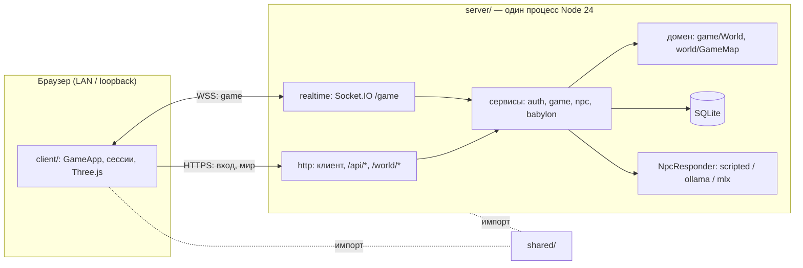

# Архитектура

Когда читать: перед любым изменением, которое пересекает границу client / server / shared, или перед добавлением нового модуля.

Офлайн 3D-игра для изучения языка в сеттинге Вавилона. До 4 активных игроков. Один ноутбук запускает сервер (Node 24), SQLite и локальную LLM; остальные игроки открывают только браузер. Второй сценарий — браузер и сервер на одном ноутбуке без Wi-Fi. Во время игры интернет не используется.

## Три части репозитория

| Часть | Каталог | Суть |
|---|---|---|
| Клиент | [client/](../../client/) | Vite + Svelte 5 + Three.js + Socket.IO Client, TypeScript strict. Только отображение, ввод и намерения. |
| Сервер | [server/](../../server/) | Один процесс Node 24: `node:http`, Socket.IO, `node:sqlite`. Авторитетный мир, вход, сохранения, NPC. |
| Общий контракт | [shared/](../../shared/) | Чистый TypeScript без зависимостей, DOM и Node. Типы и runtime-валидация протокола, формат карты, проходимость, общая кинематика. |

Клиент и сервер не импортируют друг друга. Оба импортируют `shared/` относительным путём (без npm workspaces). Один Vite-проект на клиент, отдельный `package.json` на сервер.

## Правила зависимостей

- Зависимости ацикличны и указывают внутрь: адаптеры → сервисы → домен → `shared/`.
- Домен (client `core`, server `game` и `world/GameMap`) headless: без DOM, `node:*`, таймеров, `Date.now()`, Socket.IO, SQLite. Время приходит через `dt` или порт `Clock`.
- Порты объявляются только на реальной границе: хранилища, `NpcResponder`, `LanguagePort`, `Clock`, `NetworkAdapter`. Модули внутри процесса вызывают друг друга напрямую.
- Адаптеры тонкие: разбор shared-парсером → вызов сервиса → сериализация. Коды ошибок PROTO и HTTP-статусы назначает только адаптер.
- Один composition root на сторону: клиентский `GameApp`, серверный `app`. Зависимости передаются в конструктор. Нет DI-контейнера, event bus, CQRS, generic-репозиториев, плагинных систем.
- Игровой шаг синхронный: без `await`, без SQLite, без ожидания NPC. Сохранение — по таймеру, LLM — за асинхронным портом в отдельном процессе.
- Проверка: dependency-cruiser (`npm --prefix client run check:imports`, `npm --prefix server run check`) и `tsc` в профиле без DOM/Node для `shared/`.

## Сервер приложения: кто что знает

| Слой | Модули `server/src/` |
|---|---|
| Composition root | `app` |
| Адаптеры | `http`, `realtime`, `persistence`, `world/loader`, `npc/adapters`, `tls`, `obs` (вывод), `cli` |
| Сервисы | `auth`, `game` (GameService), `npc` (NpcDialogueService), `babylon`, `content` |
| Домен | `game` (World, AOI, delta), `world` (GameMap, access), `city` |
| Общее | `common` (logger, metrics, TokenBucket, time) |

Подробности — [server.md](server.md). Клиентские модули — [client.md](client.md).

## Что где лежит

| Что | Где |
|---|---|
| Игровой протокол v3, валидаторы, fixtures | [shared/protocol/](../../shared/protocol/) |
| HTTP-подконтракт BABEL (v2) | [shared/babylon/](../../shared/babylon/) |
| Сущности и компоненты | [shared/world/types.ts](../../shared/world/types.ts) |
| Manifest, чанки, проходимость, ceilings | [shared/map/](../../shared/map/) |
| Общая кинематика движения | [shared/movement/simulation.ts](../../shared/movement/simulation.ts) |
| Живой мир (кошки, птицы, горшки, яблоки) | [shared/world-life/](../../shared/world-life/) |
| Дробовик | [shared/shotgun/](../../shared/shotgun/) |
| Каталог города (районы, жители) | [shared/city/](../../shared/city/) |
| Облики и экипировка | [shared/avatar/](../../shared/avatar/), [shared/equipment/](../../shared/equipment/) |
| Мир (генерируется клиентскими скриптами) | `client/public/maps/*`, генераторы в [client/scripts/](../../client/scripts/) |
| Контент NPC (исходник) | [server/content/npcs.json](../../server/content/npcs.json) |
| Миграции SQLite | [server/src/persistence/migrations/](../../server/src/persistence/migrations/) |
| Локальная LLM (workers, подготовка) | [server/llm/](../../server/llm/) |

## Авторитет и граница доверия

- Сервер назначает `playerId`, позицию, результат взаимодействия, ответ NPC, прогресс заданий. Клиент шлёт только намерения.
- Правильные ответы городских заданий и переходы живут только в [server/src/city/](../../server/src/city/); клиентские координаты не источник прогресса.
- Пользовательские данные недоверенные с обеих сторон; входящее всегда проходит runtime-парсер из `shared/`. Типы TypeScript валидацию не заменяют.
- Игровые каналы требуют сессию (handshake Socket.IO и Bearer на `/world/*`). Публичного fallback к картам нет.
- `shared/` — чистый код: импорты только внутри `shared/`, относительные, с расширением `.ts`, только стираемый синтаксис (без `enum`, `namespace`, parameter properties). Так сервер запускается встроенным удалением типов Node, а клиент собирается Vite.
- Режимы клиента: `OnlineSession` (реальный сервер), `LocalSession` (прогулка без сервера, только Vite-стенд), mock-сеть (только разработка). В серверной поставке доступен только online; ни `LocalSession`, ни mock не подтверждают сервер, авторизацию или ИИ.
- Клиент и сервер обновляются одной поставкой: протокол строгий, неизвестные поля отклоняются, старые версии игрового Socket.IO (v1/v2) получают `VERSION`.

## Принятые рамки

Нет микросервисов, облачной БД, внешних ИИ-API, обратного прокси. Вне текущего MVP: WebXR/VR, бой (кроме дробовика), универсальный квестовый движок, редактор карт, мобильные браузеры, больше 4 игроков и несколько групп одновременно. Решения и обоснования — [../decisions/README.md](../decisions/README.md).
