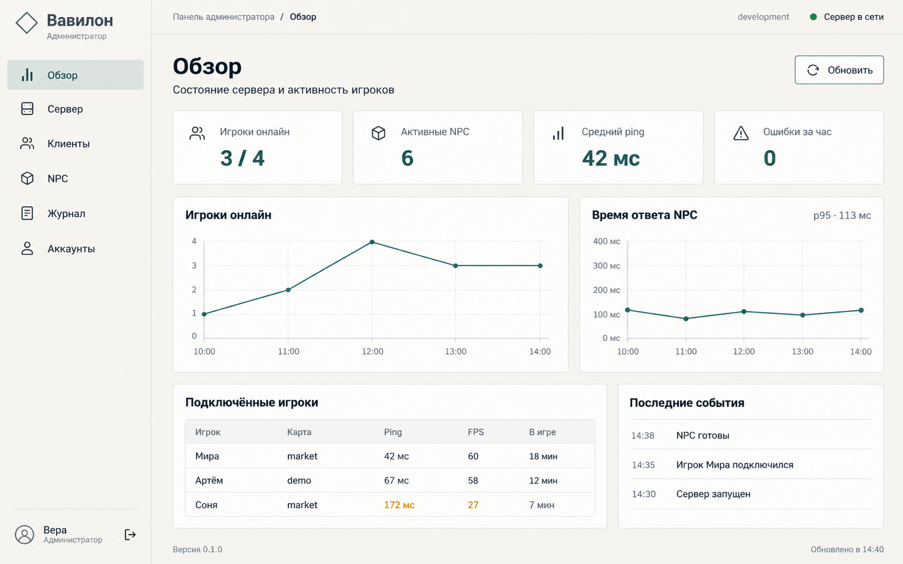
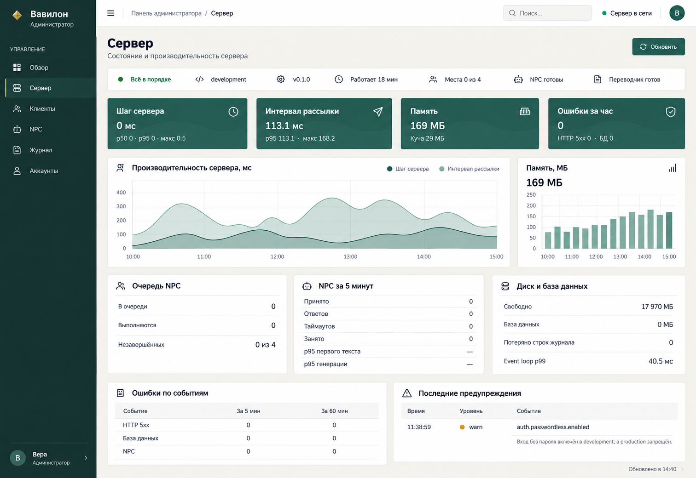
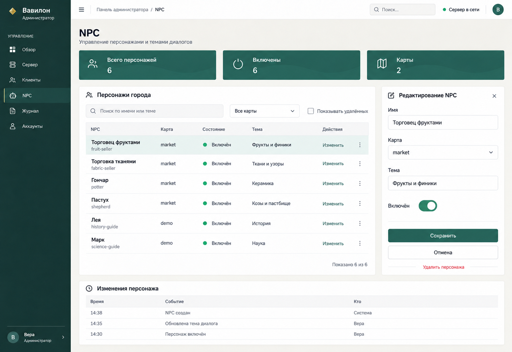
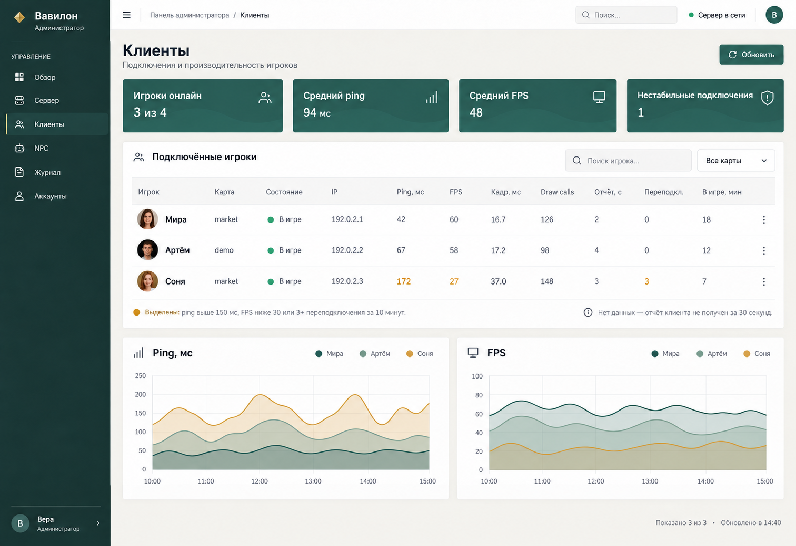
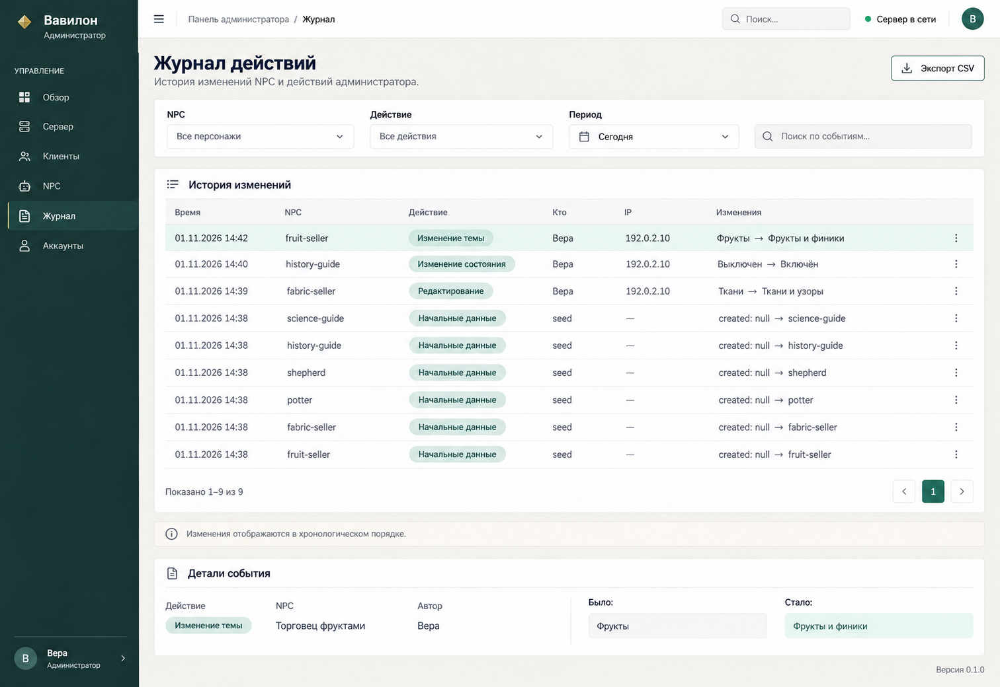
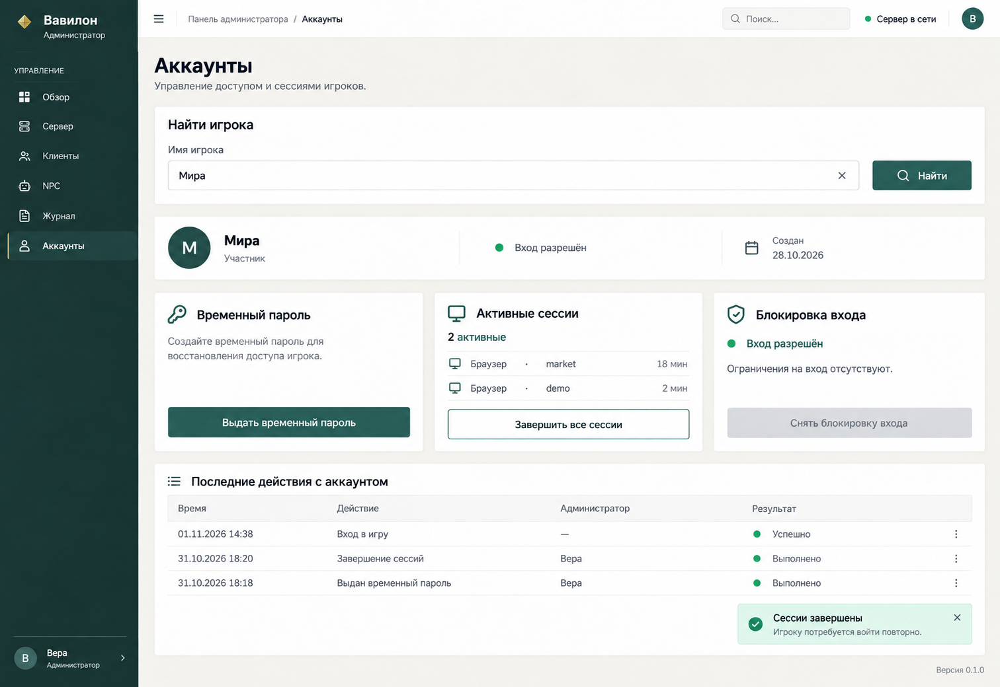

# ADMIN — Панель администратора

## Цель

Дать администратору одну страницу, где видно, как работают сервер и игроки, и где можно помочь игроку или поправить персонажа, не открывая терминал. Эта спека описывает вид и поведение страницы по макетам. Доступ, данные и пороги задают серверные спеки: экран администратора `/operator` ([OFFLINE](offline-multiplayer.md), OFFLINE-010), наблюдаемость ([OBS](server-observability.md), OBS-006–015, 017), действия администратора ([AUTH](server-auth.md), AUTH-010), правка NPC, живой мир, журнал и данные аккаунтов ([ADMIN-SRV](server-admin-content.md)).

## Макеты

| Раздел | Макет |
|---|---|
| Обзор |  |
| Сервер |  |
| NPC |  |
| Клиенты |  |
| Журнал |  |
| Аккаунты |  |

Файлы макетов: [admin_obzor.png](images/admin_obzor.png), [admin1.png](images/admin1.png), [admin2.png](images/admin2.png), [admin3.png](images/admin3.png), [admin4.png](images/admin4.png), [admin5.png](images/admin5.png).

## Требования

### Доступ и общий каркас

- **ADMIN-001:** Панель — это страница `/operator`, доступная только с самого компьютера-сервера (loopback, OFFLINE-010). С других адресов — 404. Отдельного входа и роли администратора нет (OBS, «Ограничения»); имя пользователя в левом нижнем углу макетов — оформление, а не требование.
- **ADMIN-002:** Слева — тёмно-зелёная боковая панель: логотип (золотой ромб, «Вавилон», «Администратор»), заголовок группы «УПРАВЛЕНИЕ» и пункты с иконками: «Обзор», «Сервер», «Клиенты», «NPC», «Журнал», «Аккаунты». Активный пункт подсвечен и отмечен золотой полосой слева. Кнопка-гамбургер сворачивает панель.
- **ADMIN-003:** Сверху — строка: хлебные крошки «Панель администратора / <раздел>», поле «Поиск…» и индикатор «● Сервер в сети» (зелёный, жёлтый или красный по общему состоянию OBS-010).
- **ADMIN-004:** У раздела — заголовок и подзаголовок, справа кнопка «Обновить». Плитки показателей — тёмно-зелёные карточки с названием, крупным значением, иконкой и короткой подписью. Внизу страницы — версия сервера и «Обновлено в ЧЧ:ММ».
- **ADMIN-005:** Данные обновляются сами: статус раз в 2 с, история раз в 10 с, графики — за последние 4 часа без переключателя периода (OBS-013, OBS-014). «Обновить» запрашивает всё сразу. При потере связи с сервером страница показывает «Сервер недоступен» и последние полученные значения с временем.
- **ADMIN-006:** Значения за порогом выделяются оранжевым цветом и подписью, а не только цветом; где нет данных — «нет данных» или «—», а не ноль. Страница работает без интернета, в окне шириной от 1024 px; графики рисуются без внешних библиотек (OBS-014).
- **ADMIN-007:** На странице никогда не показываются токены, пароли, тексты чата, вопросов и ответов NPC, переводы, записи словаря и рисунки камней (OBS-006).

### Обзор

- **ADMIN-008:** Раздел «Обзор» — сводка по OBS-014: плитки «Игроки онлайн N / 4», «Активные NPC», «Средний ping», «Ошибки за час»; графики «Игроки онлайн» и «Время ответа NPC» (p95 в заголовке); таблица «Подключённые игроки» (игрок, карта, ping, FPS, в игре) и «Последние события» (время и короткое сообщение по-русски).

### Сервер

- **ADMIN-009:** Под заголовком — строка состояния: «● Всё в порядке» (или причины по OBS-010), окружение (`development`/`production`), версия, «Работает N мин», «Места X из 4», «NPC готовы», «Переводчик готов».
- **ADMIN-010:** Плитки: «Шаг сервера» (текущее значение, p50 · p95 · макс), «Интервал рассылки» (p95 · макс), «Память» (RSS и куча), «Ошибки за час» (HTTP 5xx · БД).
- **ADMIN-011:** Графики: «Производительность сервера, мс» — два ряда «Шаг сервера» и «Интервал рассылки» с легендой; «Память, МБ» — столбцы по времени с текущим значением в заголовке.
- **ADMIN-012:** Карточки-таблицы:
  - «Очередь NPC» — в очереди, выполняются, незавершённых «N из 4»;
  - «NPC за 5 минут» — принято, ответов, таймаутов, занято, p95 первого текста, p95 генерации;
  - «Диск и база данных» — свободно, размер БД, потеряно строк журнала, event loop p99;
  - «Ошибки по событиям» — HTTP 5xx, база данных, NPC за 5 и за 60 мин;
  - «Последние предупреждения» — время, уровень (цветная точка), событие и пояснение по-русски (например, «Вход без пароля включён в development; в production запрещён»).

### Клиенты

- **ADMIN-013:** Плитки: «Игроки онлайн N из 4», «Средний ping», «Средний FPS», «Нестабильные подключения».
- **ADMIN-014:** Таблица «Подключённые игроки» с поиском по имени и фильтром «Все карты»: аватар облика, имя, карта, состояние («● В игре» или «вышел, место удержано N с»), IP, ping, FPS, кадр (мс), draw calls, «Отчёт, с» (давность последнего отчёта клиента), переподключения за 10 мин, в игре (мин), меню «⋮» с действиями игрока.
- **ADMIN-015:** Под таблицей — пояснение: «Выделены: ping выше 150 мс, FPS ниже 30 или 3+ переподключения за 10 минут» и «Нет данных — отчёт клиента не получен за 30 секунд» (OBS-010, OBS-011).
- **ADMIN-016:** Графики «Ping, мс» и «FPS» — по ряду на игрока, цвета подписаны в легенде.

### NPC

- **ADMIN-017:** Плитки: «Всего персонажей», «Включены», «Карты».
- **ADMIN-018:** Таблица «Персонажи города» с поиском по имени или теме, фильтром «Все карты» и флажком «Показывать удалённых»: имя и идентификатор (например, «Торговец фруктами», `fruit-seller`), карта, состояние («● Включён»/«Выключен»), тема, ссылка «Изменить» и меню «⋮». Внизу — «Показано N из M».
- **ADMIN-019:** «Изменить» открывает справа панель «Редактирование NPC». Поля и их доступность — по `editable` из ADMIN-SRV:
  - всем: «Имя», «Тема», «Характер» (persona, до 500 символов в одну строку), «Приветствие», «Радиус разговора», переключатель «Включён»;
  - NPC с собственной моделью ещё: «Карта» (список), «Позиция» (x, z; y по поверхности), «Поворот», «Облик» (список `appearances`);
  - у «вшитого» NPC (`embedded`) поля карты, позиции и облика не показываются, вместо них пояснение «Фигура нарисована в карте: переместить или сменить облик нельзя; при выключении фигура останется, исчезнут разговор и подпись»;
  - у NPC задания BABEL (`quest`) перед выключением или удалением — предупреждение «Персонаж участвует в задании рынка: без него задание нельзя пройти»;
  - кнопки «Сохранить» и «Отмена», ссылка «Сбросить к исходному» для NPC из файла с изменениями (`overridden` не пуст), ссылка «Удалить персонажа» красным. Удаление и сброс требуют подтверждения; удалённый персонаж скрыт, но виден с флажком «Показывать удалённых» и может быть восстановлен.

  Над таблицей — кнопка «Создать персонажа»: та же панель с полем «Идентификатор» и обязательным обликом из списка (ADMIN-SRV-003). Ошибка сервера показывается текстом `message` рядом с полем.
- **ADMIN-020:** Изменения применяются без перезапуска сервера (ADMIN-SRV-005): выключенный или удалённый персонаж пропадает из мира, его незавершённые ответы отменяются (NPC-004); включённый появляется на своей карте. Изменение темы, характера и приветствия влияет только на новые вопросы.
- **ADMIN-021:** Внизу — таблица «Изменения персонажа» для выбранного NPC: время, событие («NPC создан», «Обновлена тема диалога», «Персонаж включён»), кто («Система» или администратор).
- **ADMIN-028 (мир):** в разделе «NPC» под таблицей — блок «Карты и живой мир»: по каждой карте число чанков и NPC, а для карты с живой сценой — revision, сколько горшков сдвинуто с исходного места и сколько яблок в руках у игроков. Кнопка «Сбросить сцену» с подтверждением возвращает горшки и яблоки на исходные места (ADMIN-SRV-008); после действия уведомление с числом возвращённых предметов и списком пропущенных («место занято игроком»).

### Журнал

- **ADMIN-022:** Раздел «Журнал действий» — история изменений NPC и действий администратора. Фильтры: цель (персонажи, мир, аккаунты), NPC («Все персонажи»), действие («Все действия»), период («Сегодня» и другие), поиск по событиям. Справа сверху — «Экспорт CSV» выгружает отфильтрованные записи.
- **ADMIN-023:** Таблица «История изменений»: время с датой, NPC (идентификатор), действие цветной плашкой («Изменение темы», «Изменение состояния», «Редактирование», «Начальные данные»), кто (`seed` для начальной загрузки или администратор), IP, изменения в виде «было → стало», меню «⋮». Постраничный вывод с кнопками страниц. Пояснение «Изменения отображаются в хронологическом порядке».
- **ADMIN-024:** Выбор строки открывает внизу «Детали события»: действие, NPC по имени, автор, поля «Было» и «Стало».

### Аккаунты

- **ADMIN-025:** Блок «Найти игрока»: поле «Имя игрока» с крестиком очистки и кнопка «Найти». Найденный игрок показывается карточкой: аватар с буквой, имя, роль «Участник», состояние входа («● Вход разрешён» или «заблокирован до ЧЧ:ММ»), дата создания.
- **ADMIN-026:** Три карточки действий (AUTH-010):
  - «Временный пароль» — пояснение и кнопка «Выдать временный пароль»; временный пароль показывается один раз и не сохраняется на странице;
  - «Активные сессии» — число и список (IP входа, давность; карта игрока, если он в мире), кнопка «Завершить все сессии». Устройство не показывается: сервер не хранит user-agent (ADMIN-SRV-010);
  - «Блокировка входа» — текущее состояние и кнопка «Снять блокировку входа», неактивная, если блокировки нет.
  Каждое действие требует подтверждения.
- **ADMIN-027:** Таблица «Последние действия с аккаунтом»: время, действие («Вход в игру», «Завершение сессий», «Выдан временный пароль»), администратор, результат с цветной точкой. После действия справа внизу появляется уведомление, например «Сессии завершены — игроку потребуется войти повторно», с крестиком.

## Сценарии

- **S1 · ADMIN-001:** Given сервер в LAN; When администратор открывает `/operator` на самом сервере и с ноутбука игрока; Then на сервере открывается панель, с ноутбука — 404.
- **S2 · ADMIN-005–006, 013–015:** Given у игрока Сони ping 172 мс, FPS 27 и 3 переподключения; When администратор открывает «Клиенты»; Then её значения выделены оранжевым с пояснением, плитка «Нестабильные подключения» показывает 1.
- **S3 · ADMIN-009–012:** Given NPC-ответчик не запустился; When администратор открывает «Сервер»; Then строка состояния жёлтая с причиной «NPC недоступны», в «Последних предупреждениях» — соответствующее событие.
- **S4 · ADMIN-019–021, 023:** Given «Торговец фруктами» с темой «Фрукты»; When администратор меняет тему на «Фрукты и финики» и сохраняет; Then новые вопросы идут с новой темой без перезапуска, в «Изменениях персонажа» и «Журнале» появилась запись «Фрукты → Фрукты и финики» с автором.
- **S5 · ADMIN-019–020:** Given игрок разговаривает с учителем (NPC с моделью); When администратор выключает его; Then незавершённый ответ отменён, учитель пропал из мира, запись в журнале есть. Given «вшитый» пастух; When его выключают; Then панель заранее предупредила, что фигура останется, а задание рынка остановится.
- **S9 · ADMIN-028:** Given игрок держит яблоко; When администратор нажимает «Сбросить сцену» и подтверждает; Then уведомление показывает число возвращённых предметов, в блоке «Карты и живой мир» яблок в руках 0.
- **S6 · ADMIN-022:** Given журнал за сегодня; When администратор фильтрует «Изменение темы» и нажимает «Экспорт CSV»; Then файл содержит только отфильтрованные записи без данных OBS-006.
- **S7 · ADMIN-025–027:** Given «Мира» в двух сессиях; When администратор находит её и нажимает «Завершить все сессии» с подтверждением; Then сессии отозваны, появилось уведомление и строка в «Последних действиях».
- **S8 · ADMIN-007:** Given игроки переписывались и задавали вопросы NPC; When администратор проходит по всем разделам и экспортирует CSV; Then нигде нет текстов сообщений, паролей и токенов.

## Ограничения и вне scope

Вход в панель по паролю и несколько администраторов с разными правами не входят в первую версию. Новый NPC создаётся только с обликом из списка, геометрия карт не редактируется, а целевая карточка NPC-AI-002 появится в панели вместе с её реализацией (ADMIN-SRV). Удалённый доступ к панели из сети запрещён.

## Открытые вопросы

- Макет «Обзора» нарисован в старом светлом стиле, остальные разделы — с тёмно-зелёной боковой панелью и плитками. Нужен новый макет «Обзора» в общем стиле.
- В таблице «Клиенты» показан IP игрока. OBS-006 его не запрещает, но нужно подтвердить, что показ IP на экране администратора допустим, особенно если экран выводится на проектор.
- Пароль можно сбросить только найдя игрока по точному имени или по части имени — не решено.
- Файл `shared/admin6.png` побайтно совпадает с `specs/images/admin5.png` и, видимо, попал в `shared/` по ошибке — в спеке не используется.
