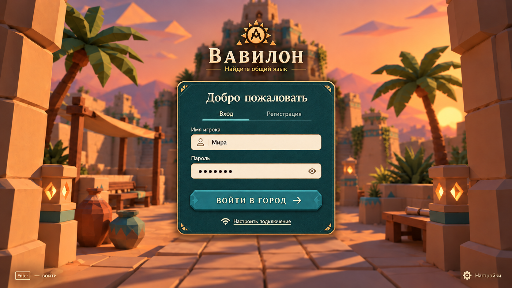
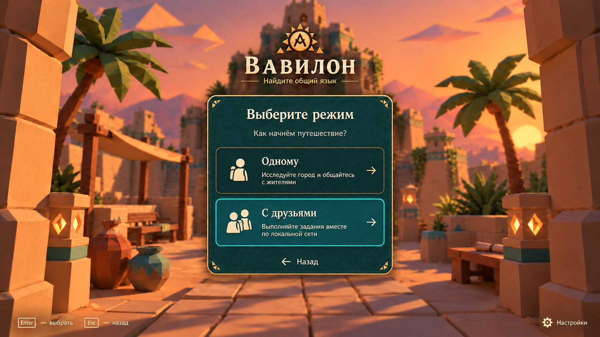

# ENTRY — Экраны входа и выбора режима

## Цель

Провести игрока от открытия страницы до старта игры: вход или регистрация, затем выбор режима. Экраны задают первое впечатление о Вавилоне и работают без интернета. Серверные правила авторизации — в [AUTH](server-auth.md), порядок входа в игру — BABEL-001 в [BABEL](game-babylon.md).

## Макеты

| Экран | Макет |
|---|---|
| Вход и регистрация |  |
| Выбор режима |  |

Файлы макетов: [auth-login.png](images/auth-login.png), [auth-mode.png](images/auth-mode.png).

## Требования

### Общее оформление

- **ENTRY-001:** Фон экранов — вид на входной двор главного здания на закате ([BUILDING](scene-main-building.md)): арка двора по краям, пальмы, фонари, сосуды, ступенчатое здание в центре. Фон одинаков для всех экранов этого потока и не мешает читать панель.
- **ENTRY-002:** Сверху по центру — логотип (солнце с буквой) и название «Вавилон» с подзаголовком «Найдите общий язык». Под ними — панель тёмно-бирюзового цвета с золотой рамкой и угловыми орнаментами; содержимое панели меняется от экрана к экрану.
- **ENTRY-003:** Внизу слева — подсказки клавиш текущего экрана (например, «Enter — войти», «Esc — назад»), внизу справа — кнопка «Настройки». Все действия доступны и мышью, и с клавиатуры.
- **ENTRY-004:** Шрифты, логотип, фон и иконки — локальные ресурсы клиента; экраны полностью работают без интернета (DEMO-003), без загрузки шрифтов или изображений из сети.

### Вход и регистрация

- **ENTRY-005:** Панель «Добро пожаловать» с двумя вкладками: «Вход» и «Регистрация». Поля: «Имя игрока» (с иконкой пользователя) и «Пароль» (с кнопкой показать/скрыть). Основная кнопка — «Войти в город →»; Enter отправляет форму.
- **ENTRY-006:** Вход и регистрация выполняются через сервер (AUTH-001–004). Клиент не хранит пароль; после успеха получает серверную сессию и передаёт её сетевому и HTTP-адаптерам (NET-007). Игровой канал открывается только после этого.
- **ENTRY-007:** Ошибки показываются в панели понятным текстом, без перезагрузки страницы: неверное имя или пароль, имя уже занято, слишком частые попытки (AUTH-004), сервер недоступен, сервер заполнен — уже 4 игрока (SERVER-006). Во время запроса кнопка заблокирована и показывает ожидание; повторные нажатия не создают повторных запросов.
- **ENTRY-008:** Ссылка «Настроить подключение» с иконкой Wi-Fi открывает настройку адреса сервера в локальной сети. По умолчанию используется тот же адрес, с которого открыт клиент (NET-006). Выбранный адрес запоминается в браузере.

### Выбор режима

- **ENTRY-009:** После успешного входа открывается панель «Выберите режим» с подзаголовком «Как начнём путешествие?» и двумя карточками:
  - «Одному» — «Исследуйте город и общайтесь с жителями»;
  - «С друзьями» — «Выполняйте задания вместе по локальной сети».
  Карточка под курсором или выбранная стрелками подсвечивается бирюзовой рамкой; Enter выбирает, Esc и кнопка «← Назад» возвращают к входу.
- **ENTRY-010:** «Назад» с экрана режима выполняет выход (AUTH-002): сессия отзывается, форма входа открывается пустой.
- **ENTRY-011:** После выбора режима игрок переходит к выбору языков и затем появляется в Вавилоне (BABEL-001, BABEL-003).

## Сценарии

- **S1 · ENTRY-001–005:** Given отключённый интернет; When игрок открывает адрес сервера; Then экран входа отображается полностью: фон, логотип, шрифты и иконки загружены локально.
- **S2 · ENTRY-005–007:** Given зарегистрированный игрок; When он вводит неверный пароль, затем верный и нажимает Enter; Then сначала видна ошибка в панели, затем открывается выбор режима; пароль нигде не сохраняется на клиенте.
- **S3 · ENTRY-007:** Given на сервере уже 4 активных игрока; When пятый входит; Then он видит сообщение «сервер заполнен», игровой канал не открывается.
- **S4 · ENTRY-008:** Given клиент открыт с другого ноутбука; When игрок меняет адрес сервера через «Настроить подключение»; Then вход идёт на новый адрес, после перезагрузки адрес сохранён.
- **S5 · ENTRY-009–011:** Given экран выбора режима; When игрок выбирает «С друзьями» клавиатурой, затем возвращается Esc и выбирает «Одному» мышью; Then подсветка и переходы работают, после выбора открывается выбор языков.

## Ограничения и вне scope

Восстановление пароля, вход через внешние сервисы и профиль игрока вне scope. Экран выбора языков на макетах не показан и описывается отдельно.

## Открытые вопросы

- Схема архитектуры описывает вход гостем по имени без пароля, а макет — вход и регистрацию с паролем. Нужно выбрать вариант и закрыть открытый вопрос AUTH о способе входа.
- BABEL-002 предусматривает режимы на 1, 2, 3 и 4 игрока, а макет — «Одному» и «С друзьями». Где выбирается число друзей и как игроки находят друг друга после выбора «С друзьями» — не решено.
- Фон — живая 3D-сцена Three.js или статичная картинка: влияет на время загрузки и нагрузку на слабые ноутбуки.
- Что открывает кнопка «Настройки» на этих экранах (язык интерфейса, звук, графика).
- Нужен ли сохранённый вход («запомнить меня») и как он согласуется со сроком сессии AUTH-002.
