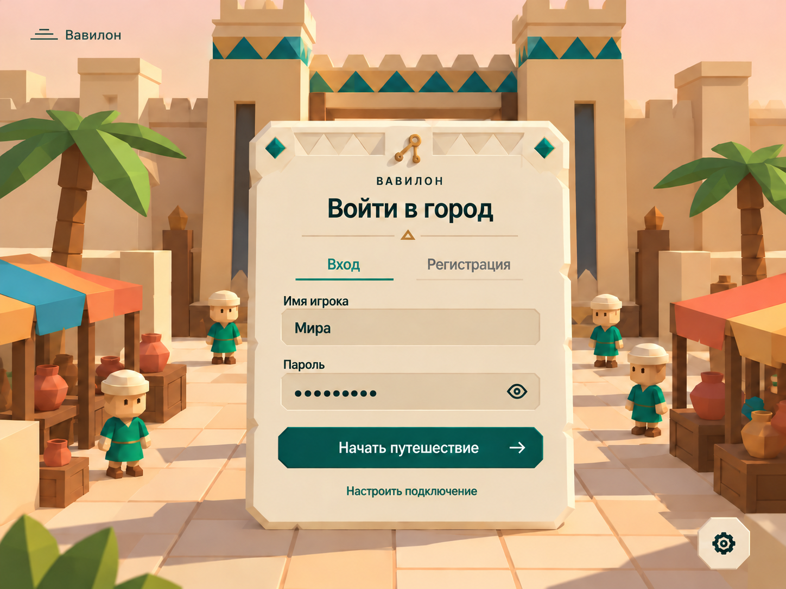
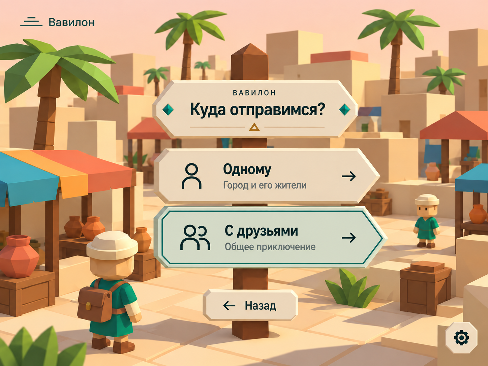

# ENTRY — Экраны входа и выбора режима

## Цель

Провести игрока от открытия страницы до старта игры: вход или регистрация, затем выбор режима. Экраны задают первое впечатление о Вавилоне и работают без интернета. Серверные правила авторизации — в [AUTH](server-auth.md), порядок входа в игру — BABEL-001 в [BABEL](game-babylon.md).

## Макеты

| Экран | Макет |
|---|---|
| Вход и регистрация |  |
| Выбор режима |  |

Файлы макетов: [autorize.png](images/autorize.png), [track.png](images/track.png).

## Требования

### Общее оформление

- **ENTRY-001:** Фон — светлая дневная сцена города в low-poly стиле: тёплое персиковое небо, песчаные стены и плиты, пальмы, торговые лавки с разноцветными навесами (бирюзовый, оранжевый, жёлтый), терракотовые сосуды, ящики и небольшие жители в зелёных туниках и светлых шапочках. На экране входа в центре фона — городские ворота с двумя башнями и поясами бирюзово-золотых треугольников; на экране выбора режима — городская улица с рынком и персонажем игрока со спины, с рюкзаком. Фон не мешает читать панель.
- **ENTRY-002:** В левом верхнем углу — логотип: три горизонтальные линии-ступени и надпись «Вавилон». В правом нижнем углу — кнопка настроек: шестерёнка на светлой восьмиугольной плашке.
- **ENTRY-003:** Панели выглядят как светлые каменные таблички цвета пергамента с неровными сколотыми краями. Акценты: тёмно-бирюзовый (основная кнопка, активные элементы), бирюзовые ромбы-самоцветы, золотисто-охристые орнаменты (треугольники, разделитель с маленьким треугольником). Над заголовком — мелкая надпись «ВАВИЛОН» разрядкой.
- **ENTRY-004:** Все действия доступны и мышью, и с клавиатуры: Tab и стрелки переключают элементы, Enter подтверждает, Esc возвращает назад. Подсказки клавиш на экране не показываются.
- **ENTRY-005:** Шрифты, логотип, фон и иконки — локальные ресурсы клиента; экраны полностью работают без интернета (DEMO-003), без загрузки шрифтов или изображений из сети.

### Вход и регистрация

- **ENTRY-006:** По центру — табличка с декоративной верхней полосой из треугольников, бирюзовыми ромбами по углам и золотым символом посередине. Заголовок «Войти в город», под ним разделитель. Две вкладки: «Вход» (активная — бирюзовый текст и подчёркивание) и «Регистрация».
- **ENTRY-007:** Поля «Имя игрока» и «Пароль» — светло-бежевые утопленные поля; у пароля кнопка с глазом показывает и скрывает ввод. Основная кнопка — тёмно-бирюзовая «Начать путешествие →»; Enter отправляет форму. Под ней — ссылка «Настроить подключение».
- **ENTRY-008:** Вход и регистрация выполняются через сервер (AUTH-001–004). Клиент не хранит пароль; после успеха получает серверную сессию и передаёт её сетевому и HTTP-адаптерам (NET-007). Игровой канал открывается только после этого.
- **ENTRY-009:** Ошибки показываются на табличке понятным текстом, без перезагрузки страницы: неверное имя или пароль, имя уже занято, слишком частые попытки (AUTH-004), сервер недоступен, сервер заполнен — уже 4 игрока (SERVER-006). Во время запроса кнопка заблокирована и показывает ожидание; повторные нажатия не создают повторных запросов.
- **ENTRY-010:** «Настроить подключение» открывает настройку адреса сервера в локальной сети. По умолчанию используется адрес, с которого открыт клиент (NET-006). Выбранный адрес запоминается в браузере.

### Выбор режима

- **ENTRY-011:** После входа (а после регистрации — после выбора облика, [AVATAR](client-avatar-select.md)) экран показывает деревянный столб-указатель со стрелками-табличками. Верхняя табличка — «ВАВИЛОН» и заголовок «Куда отправимся?» с бирюзовыми ромбами по бокам и разделителем. Ниже две таблички-стрелки, указывающие вправо:
  - «Одному» — «Город и его жители», иконка одного человека;
  - «С друзьями» — «Общее приключение», иконка двух человек.
  Выбранная табличка подсвечивается мятным фоном и двойной бирюзовой рамкой. У каждой справа стрелка «→».
- **ENTRY-012:** Внизу на столбе — маленькая табличка «← Назад». Она и Esc выполняют выход (AUTH-002): сессия отзывается, открывается пустая форма входа.
- **ENTRY-013:** После выбора режима игрок переходит к выбору языков и затем появляется в Вавилоне (BABEL-001, BABEL-003).

## Сценарии

- **S1 · ENTRY-001–005:** Given отключённый интернет; When игрок открывает адрес сервера; Then экран входа отображается полностью: фон с воротами, логотип, шрифты и иконки загружены локально.
- **S2 · ENTRY-006–009:** Given зарегистрированный игрок; When он вводит неверный пароль, затем верный и нажимает Enter; Then сначала на табличке видна ошибка, затем открывается выбор режима; пароль нигде не сохраняется на клиенте.
- **S3 · ENTRY-009:** Given на сервере уже 4 активных игрока; When пятый входит; Then он видит сообщение «сервер заполнен», игровой канал не открывается.
- **S4 · ENTRY-010:** Given клиент открыт с другого ноутбука; When игрок меняет адрес через «Настроить подключение»; Then вход идёт на новый адрес, после перезагрузки адрес сохранён.
- **S5 · ENTRY-004, 011–013:** Given экран выбора режима; When игрок выбирает «С друзьями» стрелками, возвращается Esc и выбирает «Одному» мышью; Then подсветка таблички и переходы работают, после выбора открывается выбор языков.

## Ограничения и вне scope

Восстановление пароля, вход через внешние сервисы и профиль игрока вне scope. Экран выбора языков на макетах не показан и описывается отдельно.

## Открытые вопросы

- Схема архитектуры описывает вход гостем по имени без пароля, а макет — вход и регистрацию с паролем. Нужно выбрать вариант и закрыть открытый вопрос AUTH о способе входа.
- BABEL-002 предусматривает режимы на 1, 2, 3 и 4 игрока, а макет — «Одному» и «С друзьями». Где выбирается число друзей и как игроки находят друг друга после выбора «С друзьями» — не решено.
- Новые макеты светлые и дневные, с городскими воротами и жителями «чиби»-пропорций, а сцены [рынка](demo-scene-market.md) и [главного здания](scene-main-building.md) описаны на закате и с упрощёнными, но обычными пропорциями. Нужно выбрать единый стиль персонажей и время суток. Городские ворота пока не описаны ни в одной спеке сцен.
- Фон — живая 3D-сцена Three.js или статичная картинка: влияет на время загрузки и нагрузку на слабые ноутбуки.
- Что открывает кнопка настроек (язык интерфейса, звук, графика).
- Нужен ли сохранённый вход («запомнить меня») и как он согласуется со сроком сессии AUTH-002.
