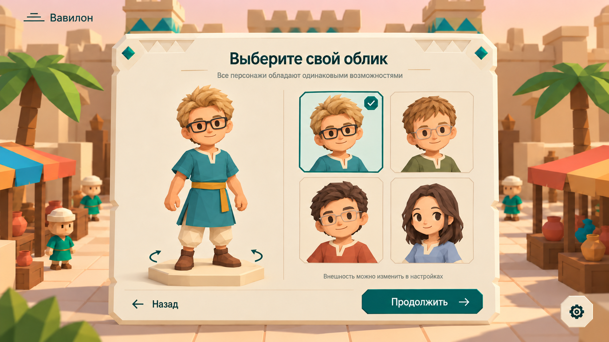
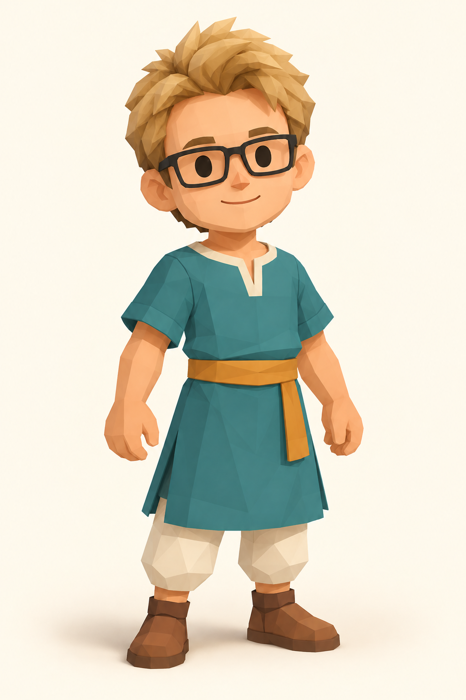
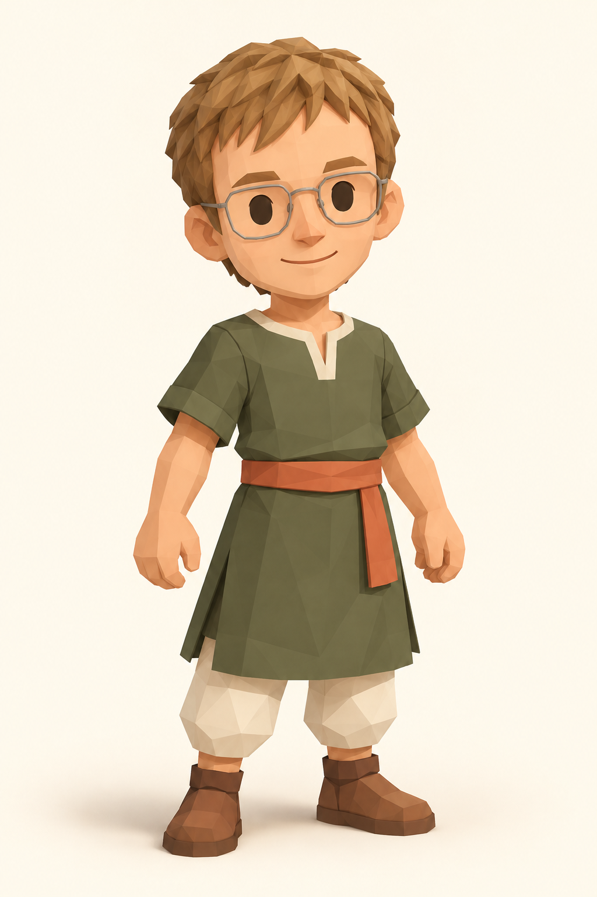
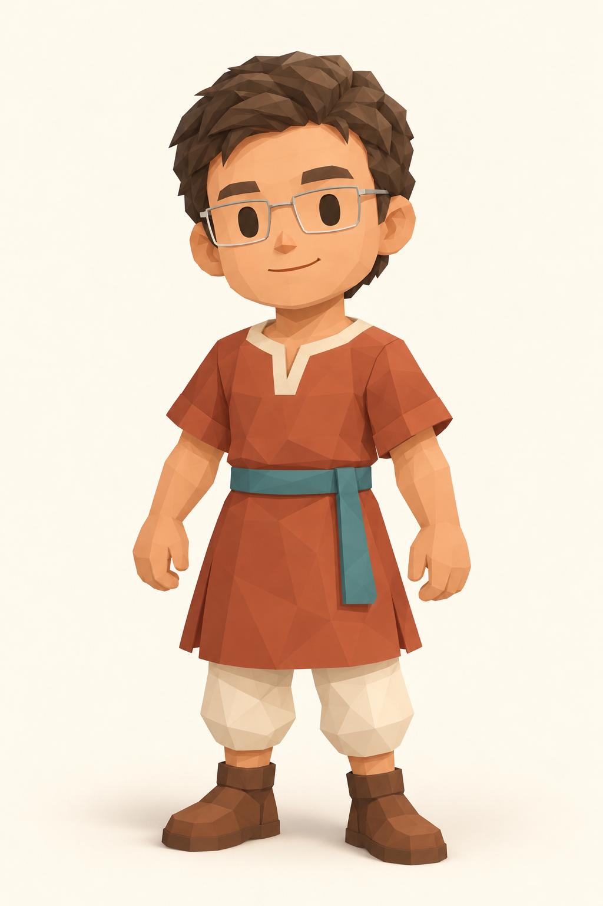
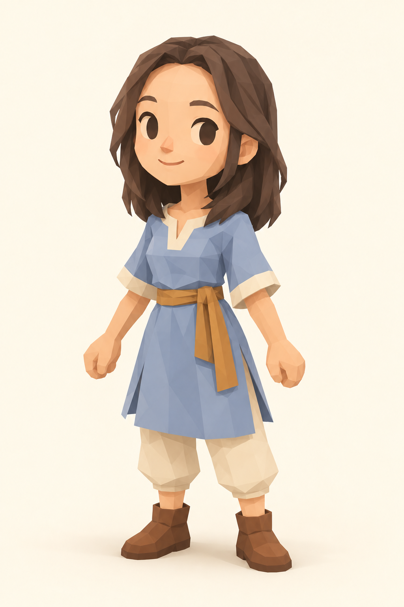

# AVATAR — Выбор облика персонажа

## Цель

Дать новому игроку выбрать, как выглядит его персонаж. Выбор доступен из личного кабинета после входа или регистрации; в игре он также доступен из настроек. Облик чисто визуальный: все персонажи обладают одинаковыми возможностями. Экран продолжает стиль [экранов входа](client-auth-screens.md).

## Макеты

| Что | Макет |
|---|---|
| Экран выбора облика |  |
| Облик «Лукас» |  |
| Облик «Ник» |  |
| Облик «Дэн» |  |
| Облик «Ксю» |  |

Файлы макетов: [oblik_page.png](images/oblik_page.png), [lukas.png](images/lukas.png), [nic.png](images/nic.png), [dan.png](images/dan.png), [ksu.png](images/ksu.png). Имена обликов — рабочие названия файлов и в интерфейсе не показываются.

## Требования

### Когда показывается

- **AVATAR-001:** После регистрации сначала открывается кабинет HUB. Выбор персонажа вызывается оттуда. Подтверждение возвращает кабинет, а не указатель режима. Вход в мир без подтверждённого облика запрещён.
- **AVATAR-002:** Незавершённый выбор после повторного входа отображается в кабинете; игрок может открыть выбор снова. Кнопки запуска мира недоступны до подтверждения, но кабинет и выход доступны.
- **AVATAR-003:** Облик можно менять из кабинета и игровых настроек. Используется один выбор с превью/сеткой и подтверждением. Закрытие возвращает к месту вызова, не выполняя logout.

### Оформление

- **AVATAR-004:** Общий фон и кнопка настроек справа снизу — как на экранах входа (ENTRY-001–003). Логотипа в левом верхнем углу нет.
- **AVATAR-005:** По центру — простая широкая карточка цвета пергамента без орнаментов. Заголовок «Выберите свой облик», под ним — «Все персонажи обладают одинаковыми возможностями».
- **AVATAR-006:** Левая часть таблички — крупное 3D-превью выбранного персонажа в полный рост на светлом шестиугольном каменном постаменте. По бокам постамента — круговые стрелки: персонажа можно вращать перетаскиванием мышью или стрелками клавиатуры. Превью показывает спокойную idle-анимацию (CHAR-005).
- **AVATAR-007:** Правая часть — сетка 2 × 2 карточек-портретов (голова и плечи). Выбранная карточка — мятный фон, бирюзовая рамка и бирюзовый значок с галочкой в углу; остальные — светлые с тонкой рамкой. Под сеткой — подсказка «Внешность можно изменить в настройках».
- **AVATAR-008:** Внизу таблички — «← Назад» и тёмно-бирюзовая «Подтвердить →». «Назад» не сохраняет неподтверждённый выбор и возвращает кабинет/настройки.

### Облики

- **AVATAR-009:** В первой версии четыре облика в одном стиле: low-poly, крупная голова, простое лицо с точками-глазами и улыбкой, туника до колен с V-образным светлым вырезом, пояс с концом, светлые широкие штаны, коричневые ботинки:
  - светлые взъерошенные волосы, чёрные прямоугольные очки, бирюзовая туника, охристый пояс ([lukas.png](images/lukas.png));
  - русые короткие волосы, светлые восьмиугольные очки, оливковая туника, терракотовый пояс ([nic.png](images/nic.png));
  - тёмные взъерошенные волосы, светлые прямоугольные очки, терракотовая туника, бирюзовый пояс ([dan.png](images/dan.png));
  - длинные тёмные волосы, голубая туника со светлыми манжетами, охристый пояс с бантом ([ksu.png](images/ksu.png)).
- **AVATAR-010:** Облики отличаются только внешностью: скорость, игровые коллизии, анимации и действия общие. По уточнению пользователя Лукас визуально выше и шире остальных; Ник, Дэн и Ксю стройнее, с более узкой талией. Ориентиры экспорта: Лукас 1.95 м высотой и 1.04 м по крайним точкам рук; остальные 1.80 м и 0.82 м. Эти художественные габариты не задают серверную коллизию. Превью сохраняет разницу роста, а не растягивает каждый облик до одинаковой высоты. Масштаб, опорная точка у стоп и суставы согласованы с CHAR-002–004.
- **AVATAR-011:** Облик игрока должен отличаться от жителей-NPC: жители носят светлые шапочки, у обликов игроков головного убора нет.

### Поведение

- **AVATAR-012:** При первом выборе активна первая карточка; при повторном открытии — подтверждённый сервером облик. Клик/стрелки меняют выбор и превью, Enter/«Подтвердить» сохраняют. Ошибка не закрывает выбор.
- **AVATAR-013:** Подтверждённый облик сохраняется на сервере в данных игрока (STORE-001) как ID из закрытого списка; клиент не может прислать произвольную модель. Ошибка сохранения показывается на табличке, переход дальше не происходит.
- **AVATAR-014:** Другие игроки видят облик игрока по данным сервера (REALTIME-002). Смена облика в настройках применяется сразу, без перезахода, и видна всем игрокам рядом.
- **AVATAR-015:** Модели и портреты — локальные ресурсы клиента и работают без интернета (DEMO-003).

## Сценарии

- **S1 · AVATAR-001, 012–013:** Регистрация → кабинет → выбор третьего облика → подтверждение → кабинет с сохранённым обликом.
- **S2 · AVATAR-001, 003:** Обычный вход → кабинет с сохранённым обликом; выбор доступен повторно по кнопке.
- **S3 · AVATAR-002:** Вкладка закрыта без подтверждения → следующий вход открывает кабинет с незавершённым выбором, запуск мира заблокирован.
- **S4 · AVATAR-006, 012:** Given экран облика; When игрок перетаскивает превью и переключает карточки стрелками; Then персонаж вращается, превью сменяется сразу, у выбранной карточки галочка.
- **S5 · AVATAR-003, 014:** Given двое игроков рядом в мире; When первый меняет облик в настройках; Then второй видит новый облик без перезахода первого.
- **S6 · AVATAR-010:** Given Лукас и другой облик рядом; When они стоят и идут; Then Лукас заметно выше и шире, остальные имеют более узкую талию; скорость и игровые коллизии одинаковы, шаг согласован с движением.

## Ограничения и вне scope

Конструктор внешности (цвет кожи, волосы, одежда по отдельности), платные или открываемые облики и смена имени на этом экране не входят в scope.

## Согласованные границы

«Назад» возвращает кабинет/настройки без отзыва сессии; обязательность первого выбора сохраняется на сервере. Смена облика открывается отдельной кнопкой существующего окна настроек. Окно приостанавливает управление; сервер применяет только явно подтверждённый closed ID. Возобновление движения требует явного захвата мыши, как другие окна HUD.

## Открытые вопросы

- Показывать ли облик напарника на карте и в чате (аватары в HUD-017 сейчас нарисованы отдельно).
