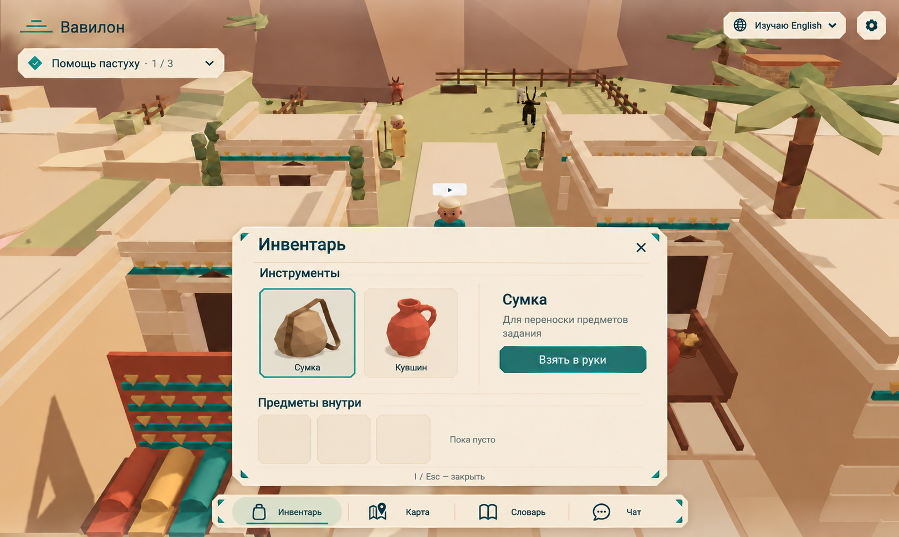
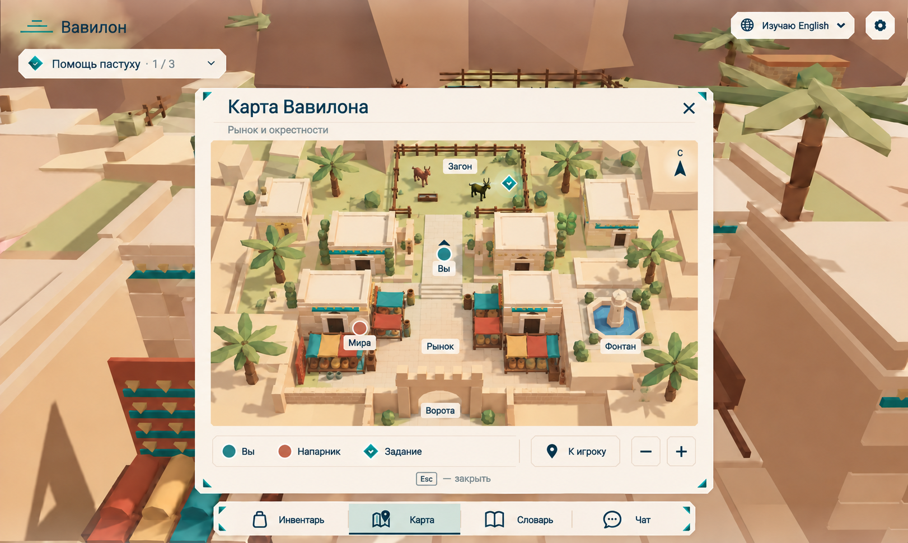
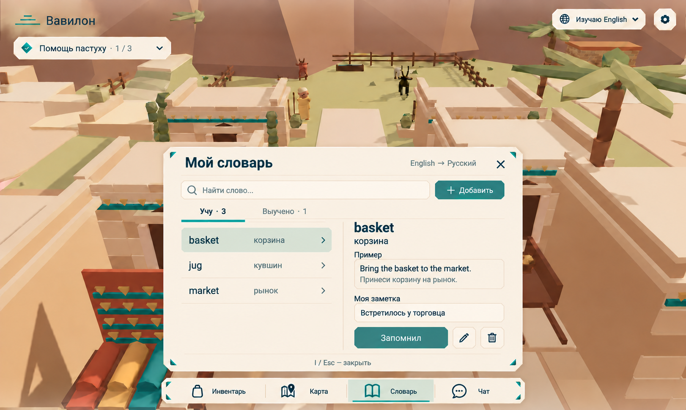
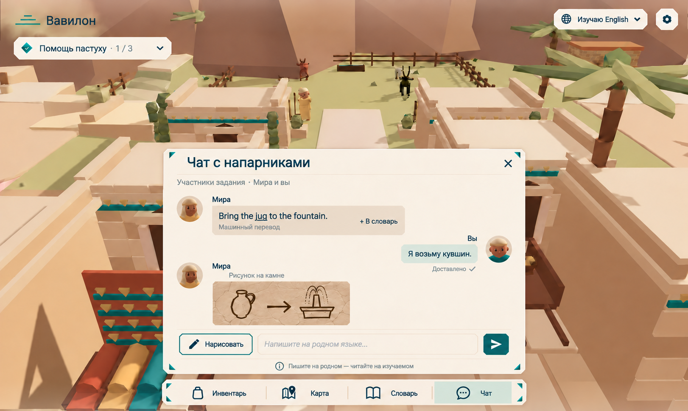

# HUD — Игровой интерфейс

## Цель

Дать игроку постоянный доступ к заданию, изучаемому языку, инвентарю, карте, словарю и чату, не закрывая мир. Интерфейс продолжает стиль [экранов входа](client-auth-screens.md): светлые панели цвета пергамента и тёмно-бирюзовые акценты. Игровые правила этих систем — в [BABEL](game-babylon.md), ввод и блокировка управления — в [UI](client-input-ui.md).

## Макеты

| Окно | Макет |
|---|---|
| Инвентарь |  |
| Карта |  |
| Словарь |  |
| Чат |  |

Файлы макетов: [inventar.png](images/inventar.png), [map.png](images/map.png), [dictionary.png](images/dictionary.png), [chat.png](images/chat.png).

## Требования

### Постоянные элементы экрана

- **HUD-001:** Мир занимает весь экран, вид сзади-сверху (BABEL-005). Интерфейс расположен по краям: центр остаётся свободным, пока не открыто окно.
- **HUD-002:** Слева сверху — логотип «Вавилон» (три линии-ступени и надпись). Под ним — плашка текущего задания: бирюзовый ромб с галочкой, название задания и прогресс («Помощь пастуху · 1 / 3»), справа стрелка раскрытия. Раскрытая плашка показывает шаги задания. Текст задания берётся из заготовленных переводов (BABEL-018), прогресс считает сервер (BABEL-019).
- **HUD-003:** Справа сверху — переключатель языка: иконка глобуса, «Изучаю English» и стрелка вниз. Он открывает список доступных языков; смена изучаемого языка сохраняется на сервере и действует для новых сообщений, заданий и ответов (BABEL-003). Рядом — квадратная кнопка настроек с шестерёнкой.
- **HUD-004:** Снизу по центру — панель из четырёх кнопок с иконками и подписями: «Инвентарь», «Карта», «Словарь», «Чат». Активная кнопка подсвечивается мятным фоном и бирюзовым подчёркиванием. По углам панели — бирюзовые треугольники.

### Окна

- **HUD-005:** Кнопка панели открывает своё окно над панелью, по центру экрана. Окно — светлая карточка с бирюзовыми треугольниками по углам, заголовком слева и крестиком справа; внизу подсказка клавиш закрытия. Мир остаётся виден по краям.
- **HUD-006:** Одновременно открыто только одно окно: нажатие другой кнопки переключает окно, повторное нажатие той же кнопки, крестик или Esc закрывают его. Пока окно открыто, захват мыши снят и движение персонажа заблокировано (BABEL-006, UI-002).
- **HUD-007:** Все окна работают и мышью, и с клавиатуры; текст из сети отображается как текст, не HTML.

### Инвентарь

- **HUD-008:** Окно «Инвентарь» (клавиша I) состоит из двух разделов. «Инструменты» — карточки предметов-вместилищ с иконкой и подписью (на макете: «Сумка», «Кувшин»); выбранная карточка обведена бирюзовой рамкой. Справа от карточек — название, описание выбранного инструмента («Для переноски предметов задания») и кнопка «Взять в руки».
- **HUD-009:** Раздел «Предметы внутри» показывает ячейки выбранного инструмента (на макете — три); пустой инструмент подписан «Пока пусто».
- **HUD-010:** «Взять в руки» отправляет на сервер команду; инструмент оказывается в руках персонажа только после подтверждения сервера и виден другим игрокам. Руки одни: взятый предмет занимает единственный слот рук (NEXT-011). Состав инвентаря задаёт сервер (BABEL-020).

### Карта

- **HUD-011:** Окно «Карта Вавилона» с подзаголовком «Рынок и окрестности» показывает иллюстрированную карту окрестностей в изометрии с подписями мест: «Загон», «Рынок», «Фонтан», «Ворота». Справа сверху — стрелка севера «С».
- **HUD-012:** На карте отмечены: игрок — бирюзовая точка со стрелкой направления и подписью «Вы»; напарник — терракотовая точка с именем; цель задания — бирюзовый ромб. Внизу — легенда этих меток, кнопка «К игроку» (центрирует карту на игроке) и кнопки масштаба «−» и «+».
- **HUD-013:** Позиции игрока и напарника на карте обновляются по данным сервера; карта не раскрывает положение игроков вне текущего задания.

### Словарь

- **HUD-014:** Окно «Мой словарь» показывает направление «English → Русский» (изучаемый → родной язык), поле поиска «Найти слово…», кнопку «+ Добавить» и вкладки «Учу» и «Выучено» с числом слов.
- **HUD-015:** Слева — список слов: слово на изучаемом языке, перевод и стрелка; выбранная строка подсвечена. Справа — карточка слова: слово, перевод, блок «Пример» (предложение на изучаемом языке и его перевод) и редактируемое поле «Моя заметка».
- **HUD-016:** Под карточкой — кнопка «Запомнил» (переносит слово во вкладку «Выучено»), кнопки «Изменить» (карандаш) и «Удалить» (корзина). Изменения сохраняются на сервере и видны только владельцу (BABEL-021–023).

### Чат

- **HUD-017:** Окно «Чат с напарниками» с подзаголовком «Участники задания · Мира и вы». Сообщения напарника — слева, с аватаром и именем; свои — справа, с аватаром.
- **HUD-018:** Сообщение напарника показывается на изучаемом языке с пометкой «Машинный перевод» (BABEL-007). Подчёркнуты только слова, которые уже есть в словаре игрока, а нажать можно на любое слово — как в разговоре с жителем ([TALK](client-npc-chat.md), TALK-007–012); у сообщения есть действие «+ В словарь». Свои сообщения показываются на родном языке со статусом «Доставлено ✓» (BABEL-011).
- **HUD-019:** Рисунок на камне показывается отдельным сообщением с подписью «Рисунок на камне» и изображением на фоне камня (BABEL-013–015).
- **HUD-020:** Внизу окна — кнопка «Нарисовать» с карандашом (открывает камень), поле «Напишите на родном языке…» и бирюзовая кнопка отправки. Под ними — подсказка «Пишите на родном — читайте на изучаемом».

## Сценарии

- **S1 · HUD-001–004:** Given игрок в мире; When он ходит по городу; Then видны логотип, плашка задания, переключатель языка, настройки и нижняя панель, центр экрана свободен.
- **S2 · HUD-005–007:** Given открыт инвентарь; When игрок нажимает «Карта», затем Esc; Then инвентарь сменяется картой, затем окно закрывается; пока окно открыто, персонаж не двигается и курсор свободен.
- **S3 · HUD-008–010:** Given у игрока сумка и кувшин; When он выбирает кувшин и нажимает «Взять в руки»; Then после подтверждения сервера кувшин в руках персонажа и виден напарнику, раздел «Предметы внутри» показывает содержимое кувшина.
- **S4 · HUD-011–013:** Given напарник на рынке; When игрок открывает карту и нажимает «К игроку»; Then видны обе метки и цель задания, карта центрируется на игроке.
- **S5 · HUD-014–016:** Given слово «basket» во вкладке «Учу»; When игрок пишет заметку и нажимает «Запомнил»; Then слово переходит в «Выучено» с заметкой и остаётся там после перезапуска.
- **S6 · HUD-017–020:** Given напарник пишет на родном языке; When приходит сообщение и игрок нажимает «+ В словарь»; Then сообщение видно на изучаемом языке с пометкой перевода, слово добавлено в словарь, а ответ игрока отображается у него на родном языке со статусом доставки.
- **S7 · HUD-003:** Given игрок изучает English; When он выбирает другой язык в переключателе; Then новые сообщения и тексты заданий приходят на новом языке, уже показанные не переписываются.

## Ограничения и вне scope

Окно настроек, мини-карта на экране без открытия окна и окно жестов на макетах не показаны и не входят в эту спеку.

## Открытые вопросы

- Подсказка в окне словаря — «I / Esc — закрыть», но I открывает инвентарь. Нужно выбрать клавиши для каждого окна (например, I — инвентарь, M — карта, K — словарь, Enter — чат).
- Предметы в инвентаре подписаны по-русски («Сумка», «Кувшин»). По идее игры названия предметов можно показывать на изучаемом языке, с переводом по наведению. Нужно решить.
- Как устроена вложенность: инструмент (сумка, кувшин) хранит предметы задания. Сколько ячеек у каждого инструмента и можно ли переложить предмет из одного в другой — не решено. Согласовать с NEXT-011 и BABEL-020.
- Камень открывается кнопкой «Нарисовать» в чате; нужен ли ему отдельный вход вне чата.
- На карте появился «Фонтан», а задание из чата — «Bring the jug to the fountain». В [рыночной сцене](demo-scene-market.md) фонтана и такого шага задания нет; сцену и задание нужно обновить.
- Переключатель показывает только изучаемый язык. Где игрок видит и меняет родной язык — не решено.
- Что показывает раскрытая плашка задания и как отмечается выполненный шаг.
