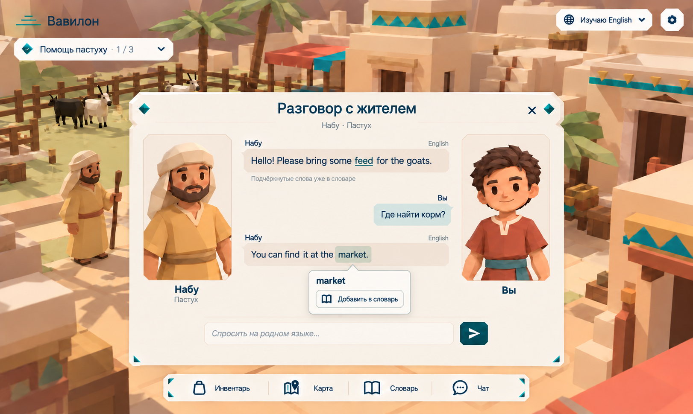

# TALK — Разговор с жителем

## Цель

Дать игроку поговорить с жителем города: игрок пишет на родном языке, житель отвечает на изучаемом. Любое слово ответа можно нажать и добавить в словарь, а уже известные слова выделены — так разговор сам становится практикой языка. Окно продолжает стиль [игрового интерфейса](client-game-hud.md); серверная часть ответа — в [NPC](server-npc-dialogue.md) и [AI](server-ai.md).

Этот draft описывает целевое окно, не готовую LLM-интеграцию BABEL. Сейчас market использует отдельный test LanguagePort, а Ollama/MLX подключены к NpcResponder на demo и отвечают по-русски. Переход к ответам на изучаемом языке и к этому окну не считается выполненным от наличия backend или общей GenerationQueue.

## Макеты

Файл макета: [chat_resident.png](images/chat_resident.png).

## Требования

### Открытие и оформление

- **TALK-001:** Окно открывается, когда игрок подходит к жителю и нажимает E (UI-001, NPC-001). Окно — простая светлая карточка по центру, без декоративных углов и подписей клавиш. Заголовок «Разговор с жителем», под ним имя и роль («Набу · Пастух»), справа крестик.
- **TALK-002:** Слева — портрет жителя (голова и плечи) с именем и ролью под ним, справа — портрет облика игрока ([AVATAR](client-avatar-select.md)) с подписью «Вы». В центре — лента сообщений, внизу — поле «Спросить на родном языке…» и тёмно-бирюзовая кнопка отправки.
- **TALK-003:** Окно ведёт себя как остальные окна HUD (HUD-005–007): одновременно открыто одно окно, Esc или крестик закрывают его, пока окно открыто, персонаж не двигается и курсор свободен. Закрытие окна отменяет незавершённый ответ (NPC-004).

### Сообщения

- **TALK-004:** Реплики жителя — слева, на светло-бежевом фоне, с именем над сообщением и названием языка справа («English»). Реплики игрока — справа, на мятном фоне, с подписью «Вы».
- **TALK-005:** Игрок пишет на родном языке; житель отвечает на изучаемом языке игрока (BABEL-016). Реплика игрока показывается так, как он её написал. Пока житель отвечает, в ленте видна отметка ожидания; ошибки и отмена показываются явным статусом, а не пустым сообщением (UI-005).
- **TALK-006:** Под первой репликой жителя с подчёркнутыми словами — серая подсказка «Подчёркнутые слова уже в словаре». Текст сообщений отображается как текст, не HTML.

### Слова и словарь

- **TALK-007:** В репликах жителя **подчёркнуты только слова, которые уже есть в личном словаре игрока** (BABEL-021), например «feed» на макете. Остальные слова выглядят как обычный текст.
- **TALK-008:** **Нажать можно на любое слово** реплики жителя, а не только на подчёркнутое. Нажатое слово подсвечивается фоном, и под ним появляется всплывающая карточка.
- **TALK-009:** Карточка слова, которого нет в словаре, показывает слово, предложенный перевод и кнопку «Добавить в словарь» с иконкой книги. После добавления слово сразу становится подчёркнутым во всех открытых сообщениях, а кнопка сменяется отметкой «В словаре».
- **TALK-010:** Карточка слова, которое уже есть в словаре, показывает слово, перевод из словаря и ссылку «Открыть в словаре», которая открывает окно словаря на этом слове (HUD-014–016).
- **TALK-011:** Слово сравнивается со словарём без учёта регистра и знаков препинания («Market.» и «market» — одно слово). Предложенный перевод формирует сервер, он помечен как предложение и может быть исправлен игроком (BABEL-023).
- **TALK-012:** Карточка закрывается кликом мимо неё, Esc или нажатием другого слова. Реплики игрока на родном языке не подчёркиваются и не нажимаются.

### Память и данные

- **TALK-013:** История разговора с жителем сохраняется на сервере; при повторном открытии окна видны последние реплики этой пары игрок–житель (STORE-006). Житель учитывает прошлые разговоры (AI-003).
- **TALK-014:** Изменения словаря из окна разговора сохраняются на сервере и видны только владельцу (BABEL-022).

## Сценарии

- **S1 · TALK-001–005:** Given игрок рядом с пастухом; When он нажимает E и пишет «Где найти корм?»; Then открывается окно с портретами, его реплика справа по-русски, ответ пастуха слева на English.
- **S2 · TALK-007:** Given «feed» есть в словаре, «market» — нет; When приходит ответ «You can find it at the market.»; Then подчёркнуто только «feed» в прежней реплике, «market» не подчёркнуто.
- **S3 · TALK-008–009:** Given слово «market» не в словаре; When игрок нажимает на него и выбирает «Добавить в словарь»; Then слово появляется в словаре и становится подчёркнутым во всех репликах окна.
- **S4 · TALK-010:** Given подчёркнутое слово «feed»; When игрок нажимает на него и выбирает «Открыть в словаре»; Then открывается окно словаря на карточке «feed».
- **S5 · TALK-008, 012:** Given реплика жителя; When игрок нажимает на неподчёркнутое слово «find», затем на «goats»; Then каждый раз открывается карточка нажатого слова, предыдущая закрывается.
- **S6 · TALK-003, 013:** Given житель ещё отвечает; When игрок закрывает окно и открывает его снова; Then незавершённый ответ отменён, прошлые завершённые реплики видны.

## Ограничения и вне scope

Озвучка слов, выделение фраз из нескольких слов и перевод целой реплики одной кнопкой не входят в эту спеку.

## Открытые вопросы

- На макете у карточки «market» нет перевода. Предложено показывать предложенный перевод до добавления, чтобы игрок понимал, что добавляет.
- Как определять слово в словаре при разных формах: «goat» в словаре и «goats» в реплике. Пока совпадение только точное (TALK-011); нормализация форм — отдельное решение.
- Нужен ли в этом окне камень (кнопка «Нарисовать»). Камень адресован игрокам, NPC рисунки не распознают (BABEL-014), поэтому на макете его нет.
- Сколько прошлых реплик показывать при повторном открытии окна.
