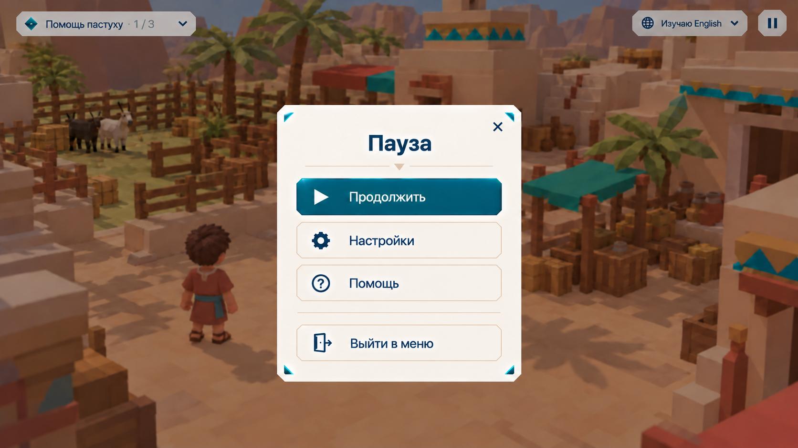

# PAUSE — Окно паузы и помощь

## Цель

Дать игроку остановиться, открыть настройки, прочитать правила игры или выйти в меню. Окно продолжает стиль [игрового интерфейса](client-game-hud.md). Раздел «Помощь» коротко объясняет правила, чтобы новый игрок разобрался без подсказок команды.

## Макеты

Файл макета: [pause.png](images/pause.png).

## Требования

### Открытие и вид

- **PAUSE-001:** Окно открывается клавишей Esc, когда не открыто другое окно (UI-001). Кнопки паузы в игровом HUD нет (HUD-003–004). Если открыто окно HUD, Esc закрывает только его (HUD-006), без появления паузы. Техническая остановка управления для модального окна сама по себе не означает открытие меню паузы. Закрытие окна HUD возвращает управление; при отказе браузера в захвате мыши показывается отдельное компактное действие «Вернуть управление», а не меню паузы.
- **PAUSE-002:** Мир за окном затемняется и слегка размывается; логотип и нижняя панель скрыты, плашка задания и переключатель языка остаются видны.
- **PAUSE-003:** Окно — светлая карточка по центру с бирюзовыми треугольниками по углам, крестиком справа сверху, заголовком «Пауза» и разделителем с маленьким треугольником.
- **PAUSE-004:** Кнопки сверху вниз:
  - «Продолжить» — главная, тёмно-бирюзовая, с иконкой ▶;
  - «Настройки» — с шестерёнкой;
  - «Помощь» — со знаком вопроса;
  - после разделителя — «Выйти в меню» с иконкой двери.
  Остальные кнопки светлые с тонкой рамкой. Выбор работает мышью, стрелками и Enter; фокус при открытии — на «Продолжить».

### Поведение

- **PAUSE-005:** «Продолжить», крестик и повторное Esc закрывают окно и возвращают управление и захват мыши.
- **PAUSE-006:** Пауза останавливает только управление этого игрока: пока окно открыто, персонаж стоит. Мир, напарники, жители и сервер продолжают работать — время задания не останавливается. Сообщения напарников продолжают приходить.
- **PAUSE-007:** «Настройки» открывают окно настроек вместо окна паузы; закрытие настроек возвращает к паузе. В настройках находится смена облика ([AVATAR](client-avatar-select.md), AVATAR-003).
- **PAUSE-008:** «Выйти в меню» выводит игрока из мира в экран выбора режима ([ENTRY](client-auth-screens.md), ENTRY-011). Сессия остаётся активной, прогресс, инвентарь и словарь уже сохранены на сервере; незавершённый ответ жителя отменяется (NPC-004). Перед выходом из совместного задания показывается подтверждение: «Напарник продолжит без вас».

### Помощь: правила игры

- **PAUSE-009:** «Помощь» открывает окно «Как играть» в том же стиле, с кнопкой «Назад» к паузе. Текст показывается на родном языке игрока. Содержание разделено на короткие блоки ниже.
- **PAUSE-010 · Цель:** Языки в Вавилоне смешались. Выполняйте задания жителей вместе с напарниками и учите язык, на котором с вами говорят.
- **PAUSE-011 · Как общаться:** Пишите на родном языке. Напарники и жители получат ваш текст на языке, который учат они, а вы читаете их ответы на своём изучаемом языке. Сообщения напарников помечены «Машинный перевод».
- **PAUSE-012 · Камень:** Если не получается объяснить словами, нажмите «Нарисовать» в чате и нарисуйте подсказку. Нарисованное нельзя стереть: высеченный камень видят все участники задания.
- **PAUSE-013 · Словарь:** Нажмите на любое слово в сообщении, чтобы увидеть перевод и добавить его в словарь. Подчёркнуты слова, которые уже есть в вашем словаре. Отмечайте выученные кнопкой «Запомнил».
- **PAUSE-014 · Задания:** Текущее задание и шаги — в плашке слева сверху. У одного игрока часто есть сведения, у другого — возможность действовать: договоритесь, кто что делает.
- **PAUSE-015 · Управление:** таблица клавиш и действий:

  | Действие | Клавиши |
  |---|---|
  | Ходить | W A S D |
  | Осмотреться | мышь |
  | Говорить с жителем, взять, использовать | E |
  | Задачи | Tab из игры |
  | Чат | 1 |
  | Словарь | 2 |
  | Карта | 3 |
  | Настройка языка | 4 |
  | Краткая подсказка | удерживать Alt / Option |
  | Пауза, закрыть окно | Esc |

## Сценарии

- **S1 · PAUSE-001–005:** Given игрок в мире без открытых окон; When он нажимает Esc, затем ещё раз Esc; Then окно паузы открывается с фокусом на «Продолжить», затем закрывается и управление возвращается.
- **S2 · PAUSE-001:** Given открыто окно карты; When игрок нажимает Esc; Then закрывается карта, а пауза не открывается.
- **S3 · PAUSE-006:** Given совместное задание; When один игрок на паузе; Then его персонаж стоит, напарник ходит и пишет, сообщения приходят игроку на паузе.
- **S4 · PAUSE-007:** Given окно паузы; When игрок открывает настройки и закрывает их; Then он снова видит окно паузы.
- **S5 · PAUSE-008:** Given игрок в совместном задании; When он нажимает «Выйти в меню» и подтверждает; Then попадает на выбор режима, при возвращении прогресс и словарь на месте.
- **S6 · PAUSE-009–015:** Given новый игрок; When он открывает «Помощь»; Then видит блоки «Цель», «Как общаться», «Камень», «Словарь», «Задания», «Управление» на родном языке и возвращается к паузе кнопкой «Назад».

## Ограничения и вне scope

Содержимое окна настроек, кроме смены облика, описывается отдельно. Обучающий режим с подсказками в мире не входит в эту спеку.

## Открытые вопросы

- В соло-режиме можно останавливать мир на паузе (жители и задание ждут). Нужно решить, отличается ли пауза в соло от совместной.
- Что ещё входит в настройки: язык интерфейса, громкость, качество графики, чувствительность мыши.
- Нужен ли в помощи пример с картинкой (как выглядят подчёркнутое слово и камень).
