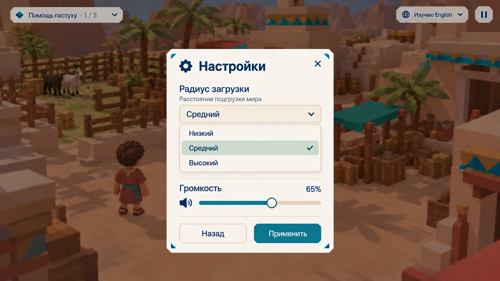

# SET — Окно настроек

## Цель

Дать игроку подстроить игру под свой ноутбук и вкус: сколько мира подгружать вокруг и насколько громко звучит игра. Окно открывается из [паузы](client-pause-menu.md) (PAUSE-007) и продолжает стиль [игрового интерфейса](client-game-hud.md).

## Макеты

Файл макета: [setting.png](images/setting.png).

## Требования

### Вид

- **SET-001:** Окно — светлая карточка по центру с бирюзовыми треугольниками по углам, мир за ней затемнён и размыт, как при паузе (PAUSE-002). Заголовок «Настройки» с иконкой шестерёнки слева и крестиком справа.
- **SET-002:** Настройки разделены тонкими линиями. Внизу — две кнопки одинаковой ширины: светлая «Назад» и тёмно-бирюзовая «Применить».

### Радиус загрузки

- **SET-003:** Блок «Радиус загрузки» с пояснением «Расстояние подгрузки мира» и выпадающим списком. Варианты: «Низкий», «Средний», «Высокий». В открытом списке текущий вариант подсвечен мятным фоном и отмечен галочкой.
- **SET-004:** Варианты соответствуют радиусу окна чанков вокруг игрока (MAP-006):

  | Вариант | Радиус | Окно чанков |
  |---|---|---|
  | Низкий | 0 | 1 × 1 |
  | Средний | 1 | 3 × 3 |
  | Высокий | 2 | 5 × 5 |

  Низкий подходит слабым ноутбукам, Высокий даёт дальний обзор.
- **SET-005:** Новый радиус применяется без перезахода и без остановки игры: лишние чанки выгружаются, недостающие подгружаются (MAP-003). Выбор не позволяет превысить бюджет памяти мира (MAP-006) и не расширяет область, которую разрешает сервер (SERVER-WORLD-002).

### Громкость

- **SET-006:** Блок «Громкость» с процентом справа («65%») и ползунком с иконкой динамика слева. Заполненная часть ползунка — бирюзовая, круглый бегунок — светлый с бирюзовой рамкой. Шаг — 5%, диапазон 0–100%, по умолчанию 30% (NEXT-015); «65%» на макете — пример.
- **SET-007:** Ползунок управляется мышью и стрелками клавиатуры. Пока игрок двигает ползунок, громкость меняется сразу, чтобы было слышно результат. При 0% иконка динамика показывается перечёркнутой.

### Применение

- **SET-008:** «Применить» сохраняет все изменения и возвращает к окну паузы. «Назад», крестик и Esc возвращают к паузе без сохранения: радиус остаётся прежним, громкость возвращается к прежнему значению.
- **SET-009:** Настройки относятся к устройству, а не к аккаунту: они сохраняются в браузере и восстанавливаются после перезагрузки страницы. При ошибке доступа к хранилищу браузера используются значения по умолчанию, игра продолжает работать.
- **SET-010:** Окно работает мышью и с клавиатуры: Tab переключает элементы, стрелки меняют вариант списка и значение ползунка, Enter подтверждает.

### Облик

- **SET-011:** Отдельной строкой — «Облик» с кнопкой «Изменить», которая открывает выбор облика ([AVATAR](client-avatar-select.md), AVATAR-003). Закрытие выбора возвращает к настройкам. Новый облик применяется после подтверждения сервером (AVATAR-013–014) и не зависит от кнопок «Применить» и «Назад».

## Сценарии

- **S1 · SET-001–004:** Given окно паузы; When игрок открывает «Настройки» и раскрывает «Радиус загрузки»; Then видит три варианта, текущий отмечен галочкой.
- **S2 · SET-005, 008:** Given радиус «Средний»; When игрок выбирает «Высокий» и нажимает «Применить»; Then вокруг игрока подгружается окно 5 × 5 без остановки игры, открывается пауза.
- **S3 · SET-007–008:** Given громкость 65%; When игрок сдвигает ползунок на 30% и нажимает «Назад»; Then во время движения звук становится тише, после «Назад» громкость снова 65%.
- **S4 · SET-009:** Given игрок выбрал «Низкий» и 40%; When он перезагружает страницу; Then настройки сохранены. Given другой ноутбук с тем же аккаунтом; Then там свои настройки.

## Ограничения и вне scope

Язык интерфейса, качество графики, чувствительность мыши и переназначение клавиш на макете не показаны и не входят в первую версию.

## Открытые вопросы

- Какой вариант выбран по умолчанию. Для карты рынка сейчас радиус 2 (MAP-006 и пояснение к нему), что соответствует «Высокому», а на макете выбран «Средний».
- Открываются ли эти же настройки с экранов входа (кнопка-шестерёнка, ENTRY-002) до входа в мир, где радиус загрузки ещё не на что применять.
- Нужно ли разделить громкость на музыку и звуки.
