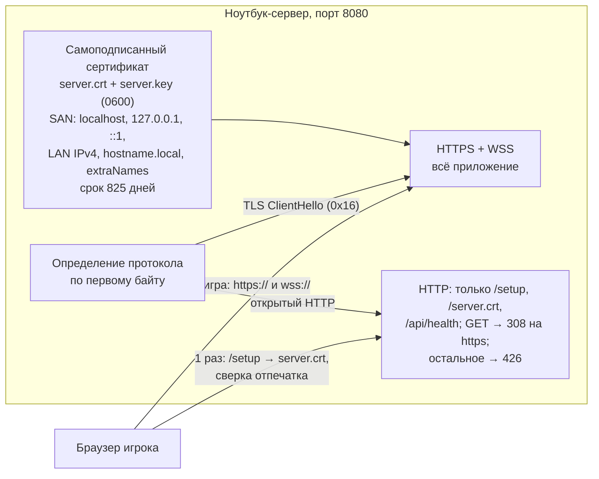

# TLS — HTTPS в LAN и соло: самоподписанный сертификат сервера

Реализует [NEXT-009](world-next-stage.md) для серверной стороны. Решения: TLS завершается **в самом игровом сервере** (`node:https`), без обратного прокси; сервер выпускает **один самоподписанный сертификат** для себя; устройство игрока **один раз** доверяет этому сертификату. HTTP-режима нет ни в одном окружении, принятый риск «HTTP без TLS» снят.

## Цель
Все запросы и ответы между браузером игрока и сервером — страница, вход с паролем, `/api/*`, `/world/*`, Socket.IO (polling и WebSocket) — идут только по TLS. Браузер показывает замок без предупреждений после одноразового доверия. Интернет, публичный домен, внешний центр сертификации и установка программ на устройства игроков не нужны. Пароль и bearer-токен не передаются открыто.

## Как это работает

Порядок для администратора: `make prepare` (или первый запуск) создаёт сертификат → блок подключения и `/operator` показывают https-адреса, адрес страницы доверия `http://<IP>:8080/setup` и отпечаток → каждый игрок один раз открывает `/setup`, скачивает сертификат, сверяет отпечаток, устанавливает по инструкции своей ОС → дальше игра открывается по `https://<IP>:8080/`.

## Компромисс самоподписанного сертификата
Устройство доверяет **этому конкретному сертификату**, а не центру сертификации. Поэтому:
- сертификат привязан к адресам, указанным в нём; если IP сервера сменился на адрес, которого в сертификате нет, браузер покажет ошибку имени;
- смена сертификата (`tls renew`) требует повторной установки на **каждом** устройстве;
- автоматического перевыпуска нет: сервер сообщает о проблеме, решение принимает администратор.

Смягчения: имя `<hostname>.local` в SAN (не зависит от IP там, где работает mDNS), `tls.extraNames` для стабильного имени, резервирование DHCP на роутере (OFFLINE-007), срок 825 дней (максимум, который принимает Apple), предупреждение за 30 дней до конца срока.

## Требования

### Сертификат
- **TLS-001 (создание):** При первом запуске, `make prepare` или `tls init` сервер создаёт самоподписанный сертификат: ECDSA P-256 + SHA-256, версия X.509 v3, случайный серийный номер, Subject `O=Вавилон LAN, CN=<первое имя>`, `notBefore` на час раньше текущего времени (расхождение часов у игроков). Существующий сертификат не заменяется никогда, кроме явной команды `tls renew --yes`.
- **TLS-003 (поля):** `basicConstraints CA:FALSE` (critical), `keyUsage digitalSignature` (critical), `extendedKeyUsage serverAuth`, `subjectAltName` — `localhost`, `<hostname>.local` (если имя хоста — обычная DNS-метка), `127.0.0.1`, `::1`, все не-loopback IPv4 на момент создания (включая link-local), `tls.extraNames`; срок 825 дней; `subjectKeyIdentifier`.
- **TLS-004 (несоответствие адресов и срок):** При запуске и при каждом запросе статуса сервер сравнивает SAN с текущими адресами и сроком. Он **не** перевыпускает сертификат сам. Непокрытые адреса и остаток срока < 30 дней попадают в блок подключения, `/operator` (красным), `lan:check` и лог `tls.names.uncovered` / `tls.certificate.expiring`. Истёкший сертификат — ошибка запуска (TLS-009).
- **TLS-005 (хранение и права):** Файлы `server.crt`, `server.key` в `tls.dir` (по умолчанию `server/data/tls/`, вне git). Ключ создаётся с правами `0600` атомарно (временный файл + rename), каталог `0700`. На POSIX права ключа шире `0600` — ошибка запуска с командой `chmod 600`. Ключ не отдаётся по HTTP, не попадает в логи, дампы, `inspect`, отчёты и клиентскую сборку.
- **TLS-006 (без внешних зависимостей):** Выпуск работает офлайн на macOS, Windows и Linux на Node 24 без OpenSSL CLI и без npm-зависимостей: ключи — `node:crypto`, X.509 кодирует собственный минимальный DER-кодировщик `server/src/tls/`, результат проверяется `crypto.X509Certificate` (подпись, соответствие ключу, имена).

### Транспорт
- **TLS-007 (HTTPS на игровом порту):** Сервер во всех окружениях слушает `host:port` по TLS (минимум TLS 1.2, ALPN `http/1.1`) и обслуживает всё приложение только через TLS: статику клиента, `/config.json`, `/api/*`, `/world/*`, `/operator`, Socket.IO `/game` (HTTPS long-polling и upgrade до WSS). Правила доступа, лимиты, CORS, проверка токена и loopback-ограничение `/operator` не меняются; CSRF-проверка действий ведущего ожидает `https://` origin loopback.
- **TLS-008 (открытый HTTP на том же порту):** Протокол определяется по первому байту соединения (`0x16` — TLS); второй порт и второе правило брандмауэра не нужны. Открытый HTTP обслуживает только:
  - `GET/HEAD /setup`, `/server.crt` (TLS-010) и `/api/health` (без секретов);
  - прочие `GET/HEAD` — `308` на `https://<тот же host:port><путь>`; заголовок Host должен быть IP-литералом или именем из SAN, иначе `400`;
  - всё остальное (POST, Socket.IO upgrade, `/api/*` кроме health) — `426 Upgrade Required` с закрытием соединения, без чтения и обработки тела: пароль и токен из такого запроса не используются и не логируются.
- **TLS-009 (HTTPS везде, никакого HTTP-режима):** Режима без TLS нет ни в одном окружении (production, development, test); настройки, отключающей TLS, не существует. Если сертификат нельзя прочитать, проверить или создать (истёк, повреждён, нет ключа, права шире `0600`), сервер не запускается и печатает причину и команду исправления. Истёкший или неподходящий сертификат никогда не приводит к работе по HTTP. HSTS не отправляется (браузеры игнорируют его для IP, а для `localhost` он сломал бы другие локальные сервисы).

### Доверие устройств игроков
- **TLS-010 (страница доверия):** `/setup` (по HTTP и HTTPS) — серверная страница без скриптов и внешних ресурсов: отпечатки SHA-256 и SHA-1 (Windows показывает SHA-1), кнопка скачивания `/server.crt` (PEM, `application/x-x509-ca-cert`), пошаговые инструкции для macOS (Связка ключей → «Всегда доверять»), Windows (доверенные корневые центры текущего пользователя), Linux/ChromeOS (менеджер сертификатов Chrome), Firefox (исключение для сертификата), кнопка «Открыть игру». На странице явно: файл скачан по HTTP, поэтому отпечаток нужно сверить с экраном администратора. Страница не показывает токены, игроков и внутренние пути.
- **TLS-011 (отпечаток у администратора):** Блок подключения при запуске и `/operator` показывают https-адреса, адрес `/setup`, отпечаток SHA-256 (группами по 4 символа), срок действия, имена в сертификате и предупреждения TLS-004.
- **TLS-012 (диагностика недоверия):** Сервер считает неудачные TLS-рукопожатия по причине (`untrusted`: клиент отверг сертификат или оборвал рукопожатие; `protocol`; `other`) в метрике `tls_handshake_failures_total{reason}`, помнит ≤ 20 последних IP с причиной `untrusted` и показывает их на `/operator` с подсказкой открыть `/setup`. Лог `tls.handshake.failed` — не чаще раза в 10 с, без содержимого запросов.

### Администрирование
- **TLS-014 (CLI):** `npm --prefix server run tls -- <команда>`: `status` (отпечаток, срок, покрытие адресов, права; код возврата 1 при проблеме), `init` (создать, если нет; идемпотентно), `renew --yes` (новый сертификат под текущие адреса; без `--yes` отказывает и напоминает про повторную установку на всех устройствах), `export <файл>` (только сертификат, без ключа, не перезаписывает файл). Команды не обращаются к сети и не трогают БД игроков.
- **TLS-015 (самопроверка):** `make prepare` выполняет `tls init`. `lan:check` (OFFLINE-008) добавляет строку «Сертификат»: отпечаток и срок, предупреждения TLS-004, права ключа; ошибка для истёкшего или повреждённого.
- **TLS-016 (конфигурация):** Объект `tls`: `dir` (относительно файла конфигурации, по умолчанию `data/tls`) и `extraNames` (≤ 8 DNS-имён или IP, попадают в SAN). Выключателя TLS нет. Development-пресет `corsOrigins` — `https://localhost:5173` (Vite dev тоже по HTTPS).

## Сценарии
- **S1 · TLS-001, 003, 005, 006:** Given пустой `tls.dir`; When `tls init` или первый запуск; Then создан сертификат с указанными полями, `crypto.X509Certificate` подтверждает самоподпись, соответствие ключу и SAN, ключ `0600`; повторный запуск и `init` его не меняют.
- **S3 · TLS-007:** Given сервер и клиент Node, доверяющий только этому сертификату; When вход, `/api/auth/state`, Socket.IO polling и WebSocket; Then всё работает по `https`/`wss`; клиент с другим доверенным сертификатом получает ошибку, а не данные.
- **S4 · TLS-008:** Given открытый HTTP на том же порту; When `GET /`, `POST /api/auth/guest`, Socket.IO handshake, Host с чужим именем; Then `308` на https, `426` без обработки (сессия не создана), отказ, `400`.
- **S5 · TLS-004:** Given сертификат без текущего адреса или с остатком < 30 дней; When запуск и запрос статуса; Then блок подключения, `/operator`, лог и `lan:check` предупреждают; сертификат не заменён; `tls renew --yes` выпускает новый, покрывающий адреса.
- **S6 · TLS-009:** Given любое окружение и истёкший сертификат, повреждённый файл, отсутствующий ключ или права ключа шире `0600`; When запуск; Then ненулевой код, понятная ошибка, порт не открыт.
- **S7 · TLS-010–012:** Given запущенный сервер; When открыть `/setup` по HTTP и HTTPS и подключиться клиентом без доверия; Then отпечаток на странице совпадает с `/operator`, `/server.crt` совпадает с файлом, ключ не отдаётся ни по одному пути; на `/operator` появляется IP отвергшего сертификат устройства, метрика растёт.
- **S8 · NEXT-009 S10 (ручной, физический):** Given ноутбук-сервер без интернета и второй ноутбук в той же сети (R1) плюс режим одного компьютера (R3); When каждое устройство один раз доверяет сертификату через `/setup`, затем вход, мир, чат, NPC; Then замок без предупреждений в Chrome/Safari/Firefox, в DevTools нет `http://`/`ws://` и mixed content; при недоверенном сертификате браузер показывает ошибку, а не переход на HTTP; после смены IP сервера на адрес вне сертификата — ошибка имени и подсказка администратору, а не тихая работа.

## Изменения связанных требований
- **OFFLINE-002:** адреса в блоке подключения — `https://`; добавляются страница доверия и отпечаток (TLS-011).
- **OFFLINE-004:** фраза «всё отдаётся по обычному HTTP» снимается; серверная часть — TLS-007–009.
- **OFFLINE-009:** `/api/health` доступен и по HTTPS, и по открытому HTTP (без секретов), чтобы проверить IP/порт до установки доверия.
- **OFFLINE-015, AUTH «Риски», SERVER, architecture:** принятый риск «HTTP без TLS» снят полностью, во всех окружениях; остаётся рекомендация сети WPA2/WPA3 как дополнительной меры.
- PROTO v3, формы сообщений, токен в памяти и порядок входа не меняются.

## Передача клиенту
Клиент использует адрес, с которого загружен (`serverUrl: null` → тот же origin), и сохраняет протокол при смене IP/порта, поэтому основная игра работает по HTTPS без изменений. Клиентской команде остаётся ([TASK-091](../tasks/091-client-https-handoff.md)): проверить отсутствие жёстких `http://`/`ws://`, по умолчанию предлагать `https` при ручном вводе адреса, показать подсказку про `/setup` при сетевой ошибке до чужого сервера (браузер не сообщает причину TLS-отказа), перевести Vite dev на HTTPS с сертификатом сервера, физическая приёмка S8.

## Ограничения и вне scope
- Публичный домен, Let's Encrypt/ACME, обратный прокси и выход в интернет — отдельная спека онлайн-развёртывания.
- Телефоны и планшеты — не целевые устройства; инструкции не обязательны.
- Автоматический перевыпуск сертификата при смене IP, центр сертификации, mTLS, отзыв (CRL/OCSP) и HTTP/2 не вводятся.
- Установка сертификата скриптом в один клик (`.command`/`.cmd`/`.sh` со страницы `/setup`) не входит в эту поставку; возможное расширение.
- Защита от администратора ноутбука-сервера или скомпрометированной ОС не обеспечивается; ключ защищён правами ОС.
- Первое скачивание сертификата по открытому HTTP защищено только сверкой отпечатка человеком.

## Принятые решения (2026-11-01)
- Самоподписанный сертификат вместо собственного центра сертификации (решение пользователя; цена — TLS-004 и раздел «Компромисс»).
- Свой DER-кодировщик на `node:crypto`, без OpenSSL CLI и новых зависимостей (TLS-006).
- HTTPS во всех окружениях, включая development и test (TLS-009, 016).
- Один порт 8080 с определением протокола (TLS-008).
